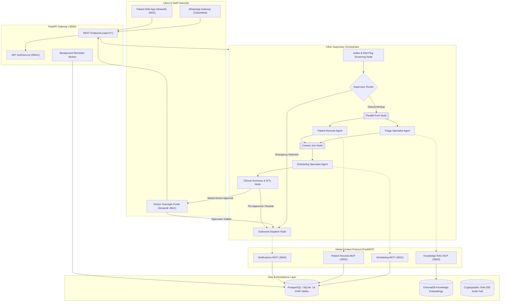
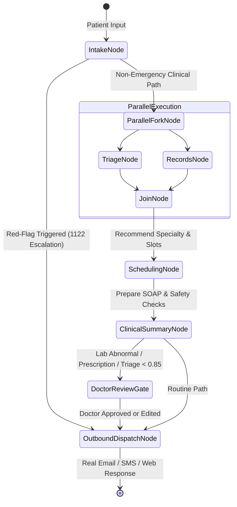

# City Care Clinics — System Architecture & Multi-Agent Design

**System:** City Care Clinics AI Clinic Assistant  
**Architecture Paradigm:** Multi-Agent State Machine (LangGraph) • Model Context Protocol (MCP) • FHIR Relational Storage • Human-in-the-Loop (HITL)  
**Target Organization:** City Care Clinics (5 Branches: Gulberg, DHA, Johar Town, F-7 Markaz, Blue Area)  

---

## 1. System Topology Overview

The architecture decouples user-facing channels (WhatsApp/Web), the centralized FastAPI backend, the LangGraph multi-agent orchestrator, FastMCP microservice tools, and persistent FHIR storage.

---

## 2. Multi-Agent Orchestration & LangGraph State Machine

The multi-agent workflow is executed via `ClinicSupervisorOrchestrator` (`week9/Day4/src/supervisor_graph.py`).

### 2.1 State Representation (`OrchestratorState`)

Every turn throughout the clinic interaction mutates a strongly-typed shared state:
- `patient_id`: Verified FHIR Patient Identifier (e.g. `PAT_001`).
- `patient_profile`: Demographic data, chronic conditions, and active medications.
- `intake_data`: Chief complaint, duration, severity scale (1-10), associated symptoms, and pregnancy/pediatric flags.
- `triage_level`: Deterministic category (`EMERGENCY`, `URGENT`, `ROUTINE`, `SELF_CARE`).
- `triage_reasoning`: Clinical rationale and protocol citations.
- `recommended_specialty`: Destination clinic specialty (e.g. `Cardiology`, `Paediatrics`).
- `available_slots`: Query results from `DoctorScheduleModel`.
- `selected_slot`: Chosen appointment date, time, and practitioner.
- `appointment_id`: Finalized booking ID.
- `clinical_summary`: Structured SOAP note (Subjective, Objective, Assessment, Plan).
- `needs_doctor_approval`: Boolean gate for doctor review.
- `doctor_approval_id`: Foreign key to `DoctorApprovalRequestModel`.
- `final_response`: Formatted message destined for the patient.

### 2.2 LangGraph Node Sequence & Invariants

#### Invariant A: Deterministic Red-Flag Short-Circuit
The `IntakeNode` executes rule-based keyword screening across English and Roman Urdu (UrduLish) before any LLM inference occurs. If an acute red flag (cardiac, stroke, severe respiratory, trauma) is detected:
1. `state["triage_level"]` is immediately set to `"EMERGENCY"`.
2. Graph execution short-circuits directly to `OutboundDispatchNode`.
3. Outbound dispatch provides immediate instructions: dial **1122**, sit calmly, and proceed to the nearest emergency facility.

#### Invariant B: True Parallel Execution
For non-emergencies, `ParallelForkNode` triggers `TriageNode` and `RecordsNode` concurrently. `RecordsNode` pulls patient history and allergies from the database, while `TriageNode` classifies clinical urgency. Both branches join at `JoinNode` to synthesize a unified clinical picture.

#### Invariant C: Doctor Human-in-the-Loop (HITL) Gate
If the interaction involves:
- Lab report interpretation
- Medication advice or prescription safety warnings
- Low-confidence triage ($< 0.85$)
`ClinicalSummaryNode` flags `needs_doctor_approval = True`, persists the draft to `DoctorApprovalRequestModel`, and halts outbound transmission until a licensed clinician reviews and approves or edits the communication.

---

## 3. Specialist Agent Roles & Responsibilities

The system divides clinical and operational responsibilities across 7 specialist agents:

| Agent Name | Primary Responsibility | Primary Tools & Models | Failure Fallback |
| :--- | :--- | :--- | :--- |
| **1. Intake Agent** | Natural conversational symptom collection, chief complaint, duration, severity | Rule-based red-flag filter + Conversational LLM | Deterministic 5-question intake checklist |
| **2. Triage Agent** | Urgency scoring (`EMERGENCY`, `URGENT`, `ROUTINE`), red-flag isolation | `TriageEngine` + Emergency protocol rules | Escalate to nearest clinic branch |
| **3. Records Agent** | Long-term memory, FHIR patient chart, condition history, chronic meds | `PatientService`, `db_models` | Query fallback to authenticated user claims |
| **4. Scheduling Agent** | Slot discovery, anti-double-booking locking, booking, rescheduling, cancellations | `DoctorScheduleModel`, `AppointmentModel` | Transaction rollback with `SLOT_CONFLICT` |
| **5. Medical Knowledge Agent** | Verified clinic FAQs, branch locations, lab prep instructions, leaflets | `ChromaDB`, Cosine RAG with source citation | "Certified clinic info unavailable" (Zero hallucination) |
| **6. Lab Report Agent** | Vision/OCR extraction of blood tests, lipid panels, LFTs, CBC; flag out-of-range | Vision LLM / Regex tabular analyzer | Require physical report handoff to doctor |
| **7. Follow-up & Reminder Agent** | Post-visit medication adherence, 7-day lab reminders, reminder invalidation | `ReminderService`, `NotificationModel` | DB-backed persistent retry queue |

---

## 4. Database Architecture (FHIR-Inspired Schema)

All persistence is managed via SQLAlchemy 2.0 with PostgreSQL in production and SQLite in development. The schema comprises 18 tables:

1. **`patients`**: Core demographic record (`id`, `mrn`, `name`, `phone`, `email`, `cnic`, `dob`, `gender`, `consent_given`).
2. **`practitioners`**: Doctor master record (`id`, `name`, `specialty`, `branch_id`, `pmdc_number`, `consultation_fee`).
3. **`clinic_branches`**: Physical facilities (`id`, `name`, `city`, `address`, `phone`, `emergency_hospital_nearby`).
4. **`doctor_schedules`**: Recurring shifts, break times, active leaves, max daily slots.
5. **`appointments`**: Booked encounters (`id`, `patient_id`, `practitioner_id`, `slot_datetime`, `status`, `token_number`, `rescheduled_from_slot`).
6. **`visits`**: Clinical encounter documentation, vitals, primary diagnosis, SOAP notes.
7. **`conditions`**: Patient chronic and acute conditions with onset dates and clinical status.
8. **`allergy_intolerances`**: Documented drug and food allergies with severity and manifestation.
9. **`medication_requests`**: Prescribed pharmaceuticals, dosage, frequency, route, and prescribing doctor.
10. **`observations`**: Quantitative and qualitative lab results, reference intervals, abnormal flags.
11. **`lab_reports`**: Lab document metadata, accession number, status, report file path.
12. **`patient_preferences`**: Preferred branch, preferred doctor, communication channel, language.
13. **`conversation_threads`**: Active and archived chat sessions with metadata.
14. **`conversation_messages`**: Fine-grained transcript turns with role (`user`, `assistant`), latency, and tokens.
15. **`doctor_approval_requests`**: HITL queue with draft messages, doctor actions (`APPROVED`, `REJECTED`, `EDITED`), and review notes.
16. **`notifications`**: Real outbound emails and SMS with delivery lifecycle (`PENDING`, `SENT`, `FAILED`, `CANCELLED`).
17. **`audit_events`**: Immutable security and clinical audit trail with cryptographic SHA-256 chaining.
18. **`users`**: Security principals with bcrypt-hashed credentials and roles (`PATIENT`, `DOCTOR`, `ADMIN`).

---

## 5. Security & Isolation Model

- **Authentication:** Stateless signed JWT bearer tokens (`HS256`) containing user ID, role, and expiration.
- **Authorization:** Granular Role-Based Access Control (RBAC). Patients are strictly restricted to their own patient ID. Cross-patient record access triggers HTTP `403 Forbidden` and creates an audit event.
- **Auditing:** Every clinical action, appointment modification, and HITL decision writes an immutable record to `audit_events`.
