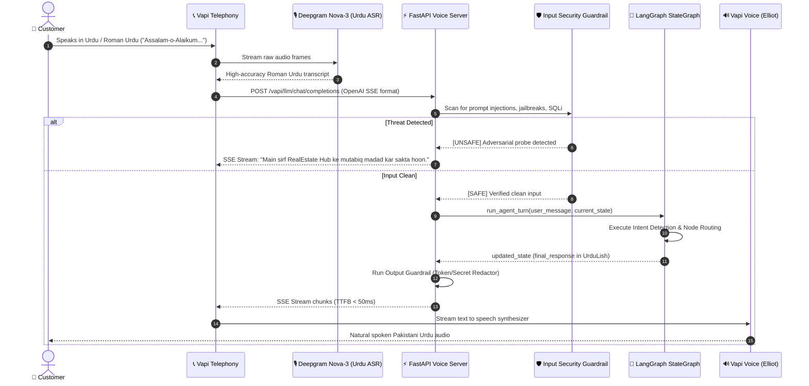
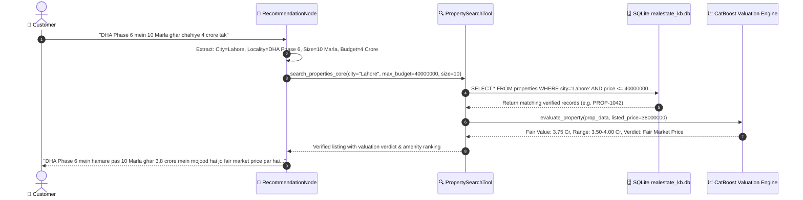
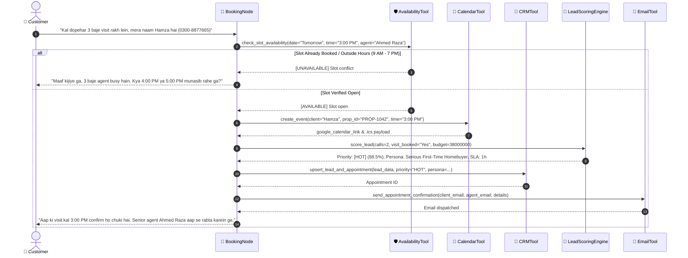
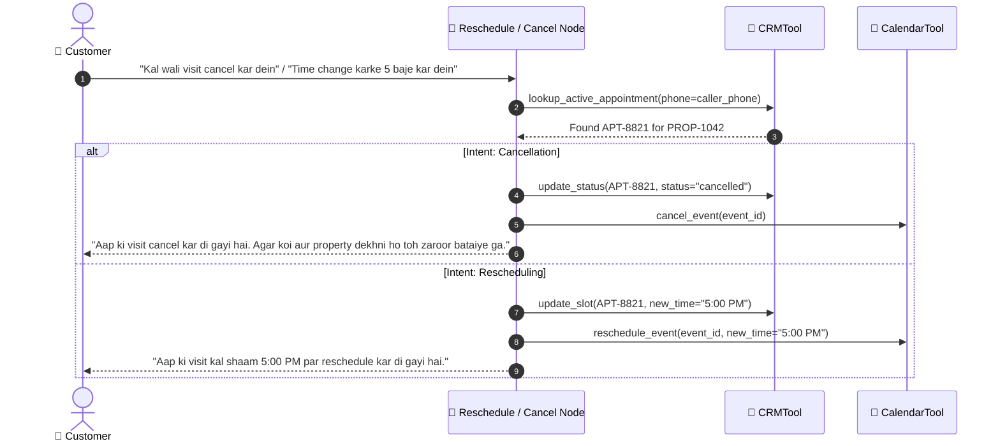
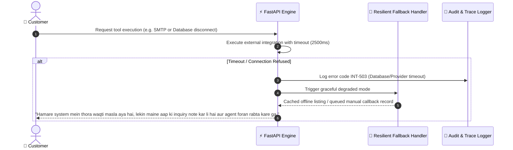
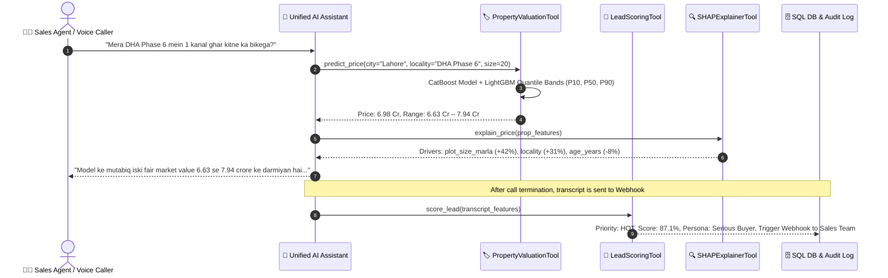

# 🏛️ Current Architecture & Operational Workflows

**Platform:** RealEstate Hub Unified Voice Agent & Machine Learning Suite  
**Version:** 2.0 (Integrated Baseline)  
**Date:** September 30, 2026  

---

## 1. Structural Overview

The current system is composed of two primary subsystem domains:

```
d:\netixsol_work/
├── week7-RE_Agent/
│   ├── day5-langgraph-agent/     # Voice telephony server, LangGraph 9-node agent, business tools
│   │   ├── db/realestate_kb.db   # 750 properties, 18 locations, CRM leads, appointments
│   │   ├── nodes/                # Greeting, Intent, Clarification, Recommendation, RAG, Booking, etc.
│   │   ├── tools/                # Search, Availability, Calendar, CRM, Email, RAG
│   │   ├── vapi_server.py        # FastAPI streaming SSE server for Vapi telephony
│   │   └── graph.py              # Compiled LangGraph StateGraph
│   └── day6-evaluation-security/ # 46-dialogue evaluation suite, security guardrails, benchmarking, Prometheus
│       ├── eval_suite/           # test_conversations.json
│       ├── security/             # Prompt injection defenses, PII redaction
│       └── monitoring/           # Prometheus metrics & Voice QoS tracking
└── week8/
    ├── Day1/                     # Cleaned property (1.7 MB) & lead (618 KB) CSV datasets
    ├── Day2/                     # CatBoost Regressor (R²=0.988) & LightGBM Quantile models (P10/P50/P90)
    ├── Day3/                     # LightGBM Lead Classifier (PR-AUC=0.562), K-Means Personas (k=4), SHAP
    ├── Day4/                     # FastAPI Serving, LangGraph 5-Tool Assistant, Streamlit Dashboard
    └── Day5/                     # Evidently AI drift monitoring, champion/challenger retraining pipeline
```

---

## 2. Sequence Diagrams

### Sequence 1: Incoming Customer Phone Call & Voice Loop



---

### Sequence 2: Property Search & Recommendation



---

### Sequence 3: Property Visit Scheduling & Anti-Double-Booking



---

### Sequence 4: Rescheduling or Cancellation



---

### Sequence 5: Telephony & Integration Failure Fallback



---

### Sequence 6: Week 8 Real-Time Valuation & Lead Triage Workflow



---

## 3. Database Schema Overview (`realestate_kb.db`)

The SQLite database contains 13 relational tables:
1. `properties`: 750 records with `property_id`, `city`, `location`, `price`, `property_type`, `plot_size_marla`, `bedrooms`, `baths`, `is_active`.
2. `locations`: 18 prime societies (DHA, Bahria, Gulberg, F-11, etc.) with development status and average marla rate.
3. `amenities`: 151 amenities linked by property identifier.
4. `developers`: 18 established builders with NOC accreditation.
5. `schools` & `hospitals`: Proximity infrastructure records.
6. `faqs`: 20 verified legal, tax (FBR), and society transfer procedures.
7. `agents`: 8 accredited human consultants with assignment schedules.
8. `crm_leads`: Captured customer leads with phone numbers and budgets.
9. `crm_appointments`: Time-slotted property viewing schedules.
10. `conversations`: Turn-by-turn transcribed dialogue history.
11. `training_data`: Continual learning dataset for periodic intent retraining.
