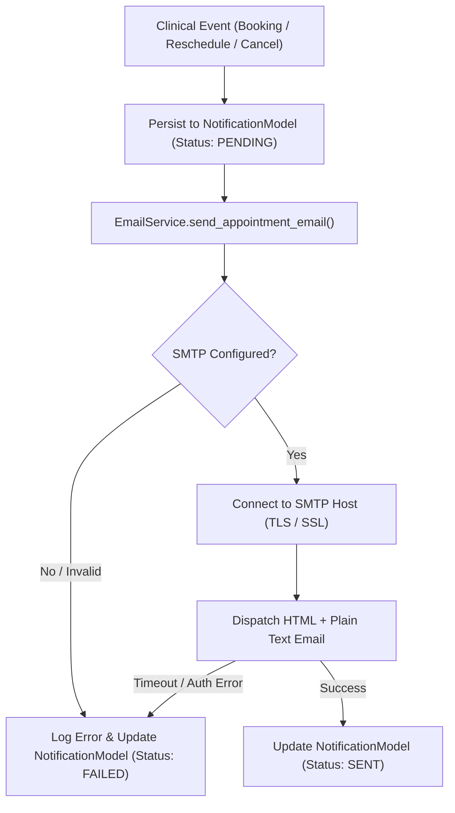

# City Care Clinics — Email Service & Background Reminder Architecture

**Classification:** Outbound Communication Engine & Persistent Reminders  
**Implementation Modules:** `week9/Day2/src/services/email_service.py`, `week9/Day2/src/services/reminder_service.py`, `week9/Day2/src/db_models.py`  

---

## 1. Real SMTP Email Delivery Architecture

The email service replaces volatile or mock messaging with a production-ready SMTP dispatch pipeline built using Python's standard `smtplib` and `email.mime` modules.



### 1.1 Responsive HTML Email Templates
The service renders branded, mobile-responsive HTML templates with plain-text alternatives:
1. **Appointment Confirmation:** Displays doctor name, specialty, branch address, date, time, sequential token number, and consultation fee.
2. **Appointment Rescheduled:** Highlights original slot, new confirmed slot, and clinic directions.
3. **Appointment Cancelled:** Confirms cancellation and offers one-click rebooking links.
4. **Upcoming Appointment Reminder:** Sends 24-hour and 2-hour pre-visit alerts with token number.
5. **Doctor-Approved Clinical Summary:** Securely delivers post-visit care plans reviewed by the doctor.

### 1.2 Error Resilience Invariant
If SMTP credentials are not configured, or if the remote mail server times out:
- The appointment booking transaction is **NOT aborted or rolled back**.
- The outbound message record is marked as `status = "FAILED"` in `NotificationModel`.
- The exact provider error (e.g. `SMTPAuthenticationError`, `ConnectionRefusedError`) is recorded in `provider_response` for audit inspection.

---

## 2. Persistent Background Reminder Worker

### 2.1 Database-Backed Queue
Volatile in-memory queues lose all scheduled reminders if a server restarts. City Care Clinics stores every reminder in the `notifications` table:
- `notification_type`: `"reminder_24h"`, `"reminder_2h"`, `"adherence_48h"`, `"lab_followup_7d"`.
- `scheduled_for`: Precise target dispatch timestamp in clinic timezone (`Asia/Karachi`).
- `status`: Lifecycle states: `PENDING`, `PROCESSING`, `SENT`, `FAILED`, `CANCELLED`.

### 2.2 Invalidation Guard for Cancelled Appointments
A critical healthcare safety defect in naive systems is sending reminders for appointments that were already cancelled or rescheduled.

The `ReminderService` enforces a strict validity check before dispatching:
```python
# Validity Check inside ReminderService.process_due_reminders()
appointment = db.query(AppointmentModel).filter_by(id=notif.appointment_id).first()
if appointment and appointment.status == "cancelled":
    notif.status = "CANCELLED"
    notif.error_message = "Skipped: Associated appointment was cancelled."
    db.commit()
    continue  # Do not dispatch email
```

### 2.3 Automated Triggering
- **Periodic Execution:** The reminder worker can be triggered via scheduled cron or the administrative REST endpoint:
  ```bash
  curl -X POST http://localhost:8000/api/v1/notifications/reminders/process
  ```
- **Process Restart Survival:** When the API server starts up, it immediately scans `notifications` for any overdue pending items and queues them for delivery.
