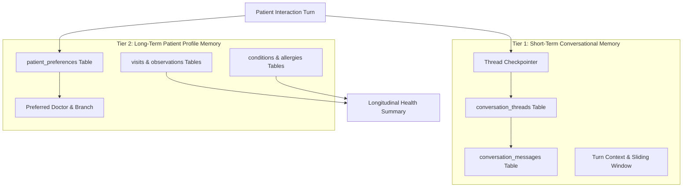

# City Care Clinics — Patient Memory Architecture & Persistence

**Classification:** Conversational Context & Longitudinal Health Record (EHR) Memory  
**Implementation Modules:** `week9/Day4/src/patient_memory.py`, `week9/Day2/src/db_models.py`, `week9/Day4/src/supervisor_graph.py`  

---

## 1. Dual-Tier Memory Architecture

The clinic assistant incorporates a dual-tier memory system designed for healthcare safety, state restoration across process restarts, and clinical longitudinal awareness:

---

## 2. Tier 1: Short-Term Conversational Memory

### 2.1 Database-Backed Thread Storage
Rather than relying on volatile in-memory storage (`MemorySaver`) that is wiped when the process restarts, all dialogue turns are persisted immediately to the relational database:
- **`conversation_threads`**: Captures `thread_id`, `patient_id`, `channel` (`web`, `whatsapp`), `status` (`active`, `closed`), and session start timestamp.
- **`conversation_messages`**: Stores each turn with `sender` (`user`, `assistant`), message text, token count, execution latency, and timestamp.

### 2.2 Thread Restoration & Fault Tolerance
- If the server restarts midway through an intake conversation, the client can resume by passing the same `thread_id`.
- The assistant retrieves the last $N$ turns from `conversation_messages` and restores the conversation state without losing the patient's symptoms or previous answers.

---

## 3. Tier 2: Long-Term Patient Longitudinal Memory

### 3.1 Patient Preferences & Clinical Affinity
Long-term preferences are stored in `patient_preferences`:
- `preferred_doctor_id`: Frequently consulted doctor (e.g., `DOC_001 Dr. Tariq Mahmood`).
- `preferred_branch_id`: Geographically preferred clinic (e.g., `BR_LHR_GULBERG`).
- `preferred_language`: `UrduLish` or `English`.
- `preferred_channel`: `whatsapp`, `web`, or `sms`.

### 3.2 Clinical History Synthesis
When a known patient is identified (via phone number, CNIC, or verified login), the system queries their longitudinal record:
- Past visits and discharge summaries (`visits` table).
- Chronic illnesses (e.g. Hypertension, Type 2 Diabetes).
- Documented drug allergies (e.g. Penicillin).
- Most recent laboratory results (e.g. HbA1c, Fasting Blood Sugar).

---

## 4. Returning Patient Conversational Flow

### 4.1 Frictionless Re-Engagement
When a returning patient reaches out to book an appointment:
1. The assistant verifies identity and checks prior records.
2. Instead of repeating basic onboarding questions ("What is your name? Which city? Do you have allergies?"), the assistant acknowledges the patient contextually:
   > *"Assalam-o-Alaikum Usman sahib! Welcome back to City Care Clinics. Would you like to book your follow-up with Dr. Tariq Mahmood at our Gulberg branch, or are you visiting for a different concern today?"*
3. If booking a routine follow-up, the scheduling flow defaults to the preferred doctor and branch automatically.

### 4.2 Privacy Preservation Invariant
- **Rule:** The assistant must **never** disclose sensitive diagnoses or stigma-associated conditions in an unsolicited greeting or push message.
- **Incorrect:** *"Assalam-o-Alaikum! Are you calling about your depression and HIV medicine?"*
- **Correct:** *"Assalam-o-Alaikum! Welcome back. How can we assist you with your health today?"*

---

## 5. Persistence Across Server Restarts Verification

Automated test `test_database_records_persistence_across_sessions` (`tests/test_notifications_and_reminders.py`) verifies that:
1. Thread messages, clinical notes, and patient preferences committed to the database remain 100% accessible after disposing and re-instantiating the database engine.
2. Returning patient recognition tests (`test_returning_patient_memory_recognition`) succeed consistently across cold-start instances.
