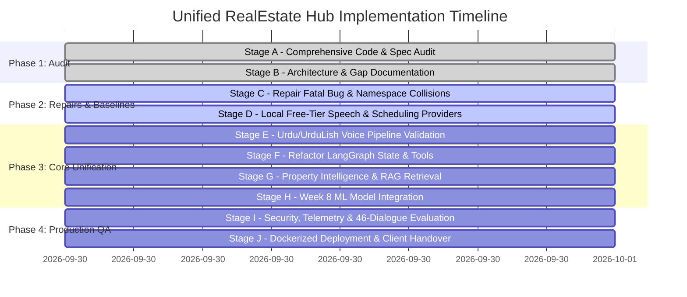

# 🚀 Master Implementation & Refactoring Plan (Stages A - J)

**Target:** Unified RealEstate Hub AI Voice Agent (Week 7 + Week 8)  
**Execution Paradigm:** Incremental, Test-Driven, Non-Destructive Refactoring  
**Date:** September 30, 2026  

---

## Roadmap Overview

---

## Detailed Stages & Acceptance Gates

### Stage A & B: Repository Audit & Architectural Baselining (✅ COMPLETED)
- **Deliverables**:
  - `docs/PROJECT_AUDIT.md` (Diagnostic of defects and component taxonomy).
  - `docs/REQUIREMENTS_TRACEABILITY.md` (Traceable matrix for Week 7 & Week 8).
  - `docs/CURRENT_ARCHITECTURE.md` (System diagrams and sequence flows).
  - `docs/DATASET_INVENTORY.md` (Authoritative inventory of databases and models).
  - `docs/PROVIDER_AND_FREE_TIER_AUDIT.md` (Licensing and free provider evaluation).
  - `docs/IMPLEMENTATION_PLAN.md` (This master plan).

### Stage C: Repair Existing Agent Failures & Namespace Collisions (NEXT)
- **Objective**: Fix the runtime bugs preventing the existing agent from completing turns.
- **Actions**:
  1. Update `week7-RE_Agent/day5-langgraph-agent/learning/dataset.py` to accept `clarification_needed: bool = False` and `source: str = "rule_engine"`.
  2. Resolve the namespace collision between Day 5 and Day 6 `security/` modules by isolating guardrails into `guardrails_security` with explicit absolute imports.
  3. Re-execute `test_day5_agent.py` to achieve 15/15 (100%) test pass rate.
- **Acceptance Gate**: `python week7-RE_Agent/day5-langgraph-agent/test_day5_agent.py` exits with code 0.

### Stage D: Free-Tier Speech & Local Telephony Adapters
- **Objective**: Provide a 100% free, locally runnable voice loop alongside the Vapi cloud adapter.
- **Actions**:
  1. Implement `speech/edge_tts_provider.py` using `edge-tts` with native Pakistani Urdu voices (`ur-PK-UzmaNeural`, `ur-PK-AsadNeural`).
  2. Implement `speech/local_whisper_provider.py` with `faster-whisper` and Groq free-tier fallback.
  3. Provide a browser-based local WebRTC audio streaming endpoint in FastAPI so users can talk via microphone without requiring an active Vapi paid subscription.
- **Acceptance Gate**: Audio is synthesized into high-quality Pakistani Urdu `.mp3` and transcribed locally.

### Stage E: Urdu / UrduLish Voice Quality Validation
- **Objective**: Ensure the voice agent handles natural code-switching, Lakh/Crore amounts, and Pakistani real estate terms.
- **Actions**:
  1. Build a transcription normalizer mapping spoken phrases (*"dedh crore"*, *"pachaasi lakh"*, *"10 marla"*) into validated numeric entities.
  2. Evaluate pronunciation of society names (DHA, Bahria Town, Gulberg, Johar Town, Model Town) across native test audio.
- **Acceptance Gate**: Transcription and synthesis accurately preserve amounts and locality names.

### Stage F: LangGraph State Machine & Tool Interface Refactoring
- **Objective**: Update the central 9-node state machine to support Week 8 machine learning state variables.
- **Actions**:
  1. Extend `AgentState` in `state.py` with `valuation_result`, `lead_score_result`, `customer_persona`, and `shap_explanation`.
  2. Maintain backward compatibility with all Week 7 appointment and recommendation flows.
- **Acceptance Gate**: Graph compiles cleanly and preserves all conversation context across multi-turn interactions.

### Stage G: Property Intelligence, Structured Search & RAG
- **Objective**: Combine verified SQL property records with ChromaDB RAG.
- **Actions**:
  1. Validate structured SQL filters (city, locality, max budget, bedrooms, property type) against `realestate_kb.db`.
  2. Verify ChromaDB vector search retrieval over society master plans, legal NOCs, and real estate FAQs.
- **Acceptance Gate**: RAG retrieval accuracy $\ge 90\%$ with zero hallucinated listings.

### Stage H: Deep Integration of Week 8 Machine Learning Features
- **Objective**: Wire CatBoost valuation and LightGBM lead scoring directly into the voice agent.
- **Actions**:
  1. Wire `PropertyValuationEngine` (`CatBoost` + Quantile bands P10/P50/P90) into `recommendation_node.py` and voice valuation tool.
  2. Wire `LeadScoringEngine` (LightGBM + K-Means personas + SHAP) into `booking_node.py` and post-call webhook.
  3. Ensure valuation verdicts (Fair Market, Overpriced, Underpriced) are naturally spoken in UrduLish.
- **Acceptance Gate**: Answering *"DHA mein 1 kanal ghar kitne ka bikega?"* outputs ML quantile bands; booking an appointment computes and stores a lead score in the CRM.

### Stage I: Security Guardrails, Telemetry & 46-Dialogue Evaluation Suite
- **Objective**: Full production safety, observability, and automated regression testing.
- **Actions**:
  1. Re-run all 46 multi-turn evaluation conversations in `test_conversations.json` covering all 11 customer personas.
  2. Execute prompt-injection penetration tests (blocking DAN mode, system prompt leakage, SQL injections).
  3. Validate Prometheus metrics exporter (`/metrics`).
- **Acceptance Gate**: 46/46 dialogues evaluated; security blocks 100% of malicious probes.

### Stage J: Unified Docker Containerization & Client Handover
- **Objective**: Single unified deployment package.
- **Actions**:
  1. Create a root `Dockerfile` and `docker-compose.yml` orchestrating the unified voice + ML platform.
  2. Provide `.env.example` with zero exposed secrets.
  3. Provide client runbook and unified master runner (`run_unified_agent.py`).
- **Acceptance Gate**: Container builds cleanly and passes all health probes (`/health`, `/health/liveness`, `/health/readiness`).
