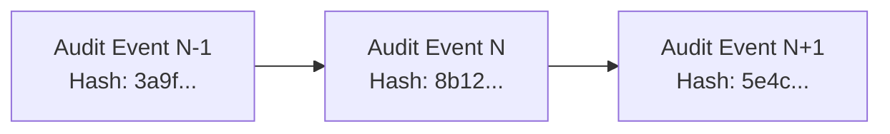

# City Care Clinics — Security, Privacy & Compliance Architecture

**Classification:** Healthcare Information Security Policy & Implementation  
**Standard Adherence:** ISO 27799 (Health Informatics), HIPAA Security Rule Principles, Pakistan PECA 2016  
**Implementation Modules:** `week9/Day5/src/services/auth_service.py`, `week9/Day2/src/db_models.py`, `week9/Day5/src/api_server.py`  

---

## 1. Authentication & Identity Management

### 1.1 Credential Hashing
- **Algorithm:** `bcrypt` with automatic salting and 12 work factor rounds.
- **Storage:** Passwords are never stored or logged in plain text. Stored strictly in `users.hashed_password`.
- **Validation:** Enforced complexity: minimum 8 characters, alphanumeric with special character requirement.

### 1.2 Stateless JWT Bearer Tokens
- **Algorithm:** HMAC with SHA-256 (`HS256`).
- **Signature Secret:** Configured via `JWT_SECRET_KEY` environment variable.
- **Expiry:** Default lifetime of 480 minutes (8 hours) for clinical shifts.
- **Claims Payload:**
  ```json
  {
    "sub": "usr_91283a",
    "username": "doctor.tariq",
    "role": "DOCTOR",
    "patient_id": null,
    "practitioner_id": "DOC_001",
    "exp": 1791800000
  }
  ```

---

## 2. Granular Role-Based Access Control (RBAC)

Three distinct clinical roles govern system capabilities:

| Permission Area | `PATIENT` Role | `DOCTOR` Role | `ADMIN` Role |
| :--- | :--- | :--- | :--- |
| **View Own Chart** | ✅ Full Access | ✅ If Assigned | ✅ Full Access |
| **View Other Patient Charts** | ❌ **FORBIDDEN (403)** | ✅ Clinical Need | ✅ Audit Review |
| **Book / Reschedule Appointments** | ✅ Self Only | ✅ Any Patient | ✅ Any Patient |
| **Access Doctor HITL Queue** | ❌ **FORBIDDEN (403)** | ✅ Full Access | ✅ Full Access |
| **Approve / Edit Clinical Drafts** | ❌ **FORBIDDEN (403)** | ✅ Full Access | ❌ Read-Only Audit |
| **Trigger Reminder Worker** | ❌ **FORBIDDEN (403)** | ❌ Restricted | ✅ Full Access |
| **View Chained Audit Log** | ❌ **FORBIDDEN (403)** | ❌ Restricted | ✅ Full Access |

---

## 3. Strict Multi-Tenant Patient Data Isolation

To prevent unauthorized cross-patient data access, the backend implements an invariant authorization guard on all patient-specific endpoints:

```python
# Authorization Guard Enforcement (api_server.py)
if current_user.role == "PATIENT" and current_user.patient_id != requested_patient_id:
    raise HTTPException(
        status_code=status.HTTP_403_FORBIDDEN,
        detail="Cross-patient access forbidden: You may only view your own records."
    )
```

### Verification
- Tested via automated test `test_cross_patient_isolation_guard` in `tests/test_patient_memory_and_isolation.py`.
- Patient A attempting to access Patient B's records immediately receives `HTTP 403 Forbidden` with zero clinical data leakage.

---

## 4. Cryptographic Chained Audit Trail

All sensitive operations write an immutable record to the `audit_events` table in SQLite/PostgreSQL.

### 4.1 Chain Structure
Each record includes a cryptographic SHA-256 hash linking it to the immediately preceding event:

$$\text{EventHash}_N = \text{SHA-256}(\text{EventHash}_{N-1} \parallel \text{Timestamp} \parallel \text{UserID} \parallel \text{Action} \parallel \text{Payload})$$



### 4.2 Audited Events
1. Patient login, logout, and token refresh.
2. Clinical chart access and export.
3. Appointment booking, rescheduling, and cancellation.
4. Doctor approval, modification, or rejection of clinical communications.
5. Outbound email and SMS dispatches.
6. Detected unauthorized access attempts (403 Forbidden).

---

## 5. Protected Health Information (PHI) & PII Redaction

### 5.1 Redaction in Logs
- All application loggers employ automatic pattern masking for:
  - Pakistani CNICs: `XXXXX-XXXXXXX-X`
  - Mobile phone numbers: `03XX-XXXXXXX`
  - Passwords and bearer authorization headers.
- Plain-text clinical conversations are never printed to terminal logs in production mode.

### 5.2 Conversational Privacy
- Inbound patient greetings do not broadcast sensitive clinical diagnoses (e.g. "Welcome back Muhammad, how is your HIV treatment?").
- Greetings reference only the patient's name and general clinic relationship (e.g. "Assalam-o-Alaikum Muhammad sahib! Welcome back to City Care Clinics.").

---

## 6. Network Security & CORS Controls

- **CORS Allowed Origins:** Restructured via `ALLOWED_ORIGINS` environment variable. Defaults to local trusted Streamlit frontends (`http://localhost:8501`, `http://localhost:8502`).
- **TLS/SSL Encryption:** Production deployments require terminating TLS at an upstream reverse proxy (Nginx or Traefik) enforcing TLS 1.3.
