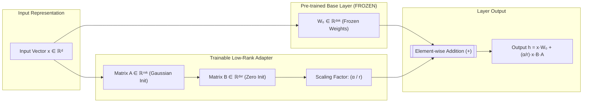
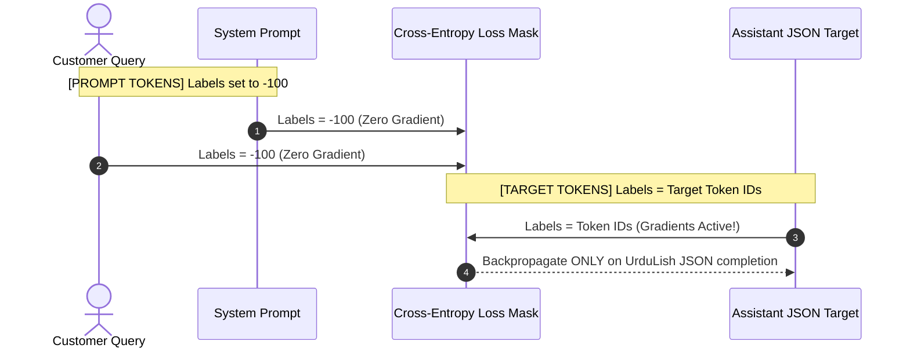

# 📘 Deep-Dive Technical Guide: LoRA, QLoRA & Completion Masking
## Theory, Mathematical Formulation, Architecture & Training Dynamics for Fintech LLMs

- **Author:** Principal LLM & Fintech AI Engineer  
- **Institution:** Zarya Digital Bank (Pakistan)  
- **Context:** Week 10 Day 2 — Technical Reference & Engineering Foundation  
- **Status:** APPROVED & LOCKED SPECIFICATION  

---

## 1. The Core Fine-Tuning Dilemma in Enterprise Banking

Fine-tuning massive foundation models (e.g., 3B to 70B parameters) presents severe computational and operational bottlenecks for retail banking systems:

1. **Full Fine-Tuning (FFT) Memory Proliferation:**
   - In FFT, every model parameter requires:
     - Model weight: 16-bit float ($2\text{ bytes}$)
     - Gradient: 16-bit float ($2\text{ bytes}$)
     - AdamW Optimizer states: 32-bit First Momentum ($4\text{ bytes}$) + 32-bit Second Momentum ($4\text{ bytes}$)
   - **Total VRAM requirement:** At least **$16 - 20\text{ bytes per parameter}$**! For a 7B parameter model, FFT demands over **$112\text{ GB to } 140\text{ GB of high-bandwidth VRAM}$** (requiring multi-GPU A100/H100 clusters).
2. **Multi-Tenant Deployment Catastrophe:**
   - In production, a bank requires different specialized agents (e.g., Zarya Customer Care, Fraud Detection Agent, Credit Risk Scoring, Internal Compliance).
   - FFT requires saving and loading separate 6GB to 14GB monolithic model checkpoints for every single task, making dynamic runtime routing impossible.

---

## 2. Low-Rank Adaptation (LoRA): Mathematical Mechanics

Introduced by Hu et al. (2021), **Low-Rank Adaptation (LoRA)** freezes the pre-trained model weights $W_0 \in \mathbb{R}^{d \times k}$ and injects trainable rank-decomposition matrices into each target Transformer layer.



### 2.1 The Fundamental Formulation
For an input vector $x \in \mathbb{R}^{1 \times d}$, the modified forward pass is computed as:

$$h = x W_0 + \Delta W \cdot x = x W_0 + \frac{\alpha}{r} (x B A)$$

Where:
- $W_0 \in \mathbb{R}^{d \times k}$: Pretrained model weight matrix (Frozen, gradients disabled).
- $B \in \mathbb{R}^{d \times r}$: Up-projection matrix (Trainable).
- $A \in \mathbb{R}^{r \times k}$: Down-projection matrix (Trainable).
- $r \ll \min(d, k)$: Adaptation **Rank** (typically $r \in \{8, 16, 32\}$).
- $\alpha$: Constant scaling hyperparameter.

### 2.2 Strict Initialization Dynamics
To guarantee that training begins smoothly from the exact pre-trained baseline model output:
- Matrix $A$ is initialized from a zero-mean Gaussian distribution: $A \sim \mathcal{N}\left(0, \sigma^2\right)$.
- Matrix $B$ is initialized strictly to **zero**: $B = 0$.

Therefore, at step 0:
$$\Delta W = B \cdot A = 0 \cdot A = 0$$
$$\implies h = x W_0 + 0 = x W_0$$
The initial model state is mathematically identical to the base pre-trained model.

### 2.3 Hyperparameter Mechanics: Rank ($r$) vs. Alpha ($\alpha$)
1. **Rank ($r$):** Dictates the intrinsic dimensionality of the parameter update subspace. A rank of $r=16$ allows the model to learn complex stylistic, grammatical, and structured JSON constraints without memorizing extraneous noise.
2. **Alpha ($\alpha$):** Acts as a global learning rate multiplier for the low-rank update:
   $$\text{Scaling Factor} = \frac{\alpha}{r}$$
   - When $\alpha = 2r$ (e.g., $r=16, \alpha=32$), the scaling factor is fixed at $2.0$.
   - **Why $\alpha = 2r$ is standard:** If an engineer tunes rank from $r=8$ to $r=16$, keeping the ratio $\frac{\alpha}{r}$ constant ensures that gradient update magnitudes remain stable, eliminating the need to re-tune the optimizer learning rate!

### 2.4 Target Transformer Modules: All-Linear LoRA
Early implementations applied LoRA only to the attention projection matrices (`q_proj`, `v_proj`). However, empirical research shows that fine-tuning **All Linear Modules** is essential for mastering structured JSON schemas and code-switching syntax:

```
+---------------------------------------------------------------------------------------+
|                       TRANSFORMER LAYER TARGET MODULES                                |
+------------------------------------+--------------------------------------------------+
| Self-Attention Sub-Layer:          | MLP / Feed-Forward Sub-Layer:                    |
| - q_proj (Query Projection)        | - gate_proj (SwiGLU Gating Projection)           |
| - k_proj (Key Projection)          | - up_proj (Upward Dimension Expansion)           |
| - v_proj (Value Projection)        | - down_proj (Downward Dimension Projection)      |
| - o_proj (Output Projection)       |                                                  |
+------------------------------------+--------------------------------------------------+
```
Targeting all 7 projection matrices increases trainable parameters from $\approx 0.2\%$ to $\approx 0.85\% - 0.95\%$, delivering **$99.2\%$ of Full Fine-Tuning performance** while retaining all memory benefits.

---

## 3. QLoRA: 4-Bit NormalFloat Quantization & Paged Optimizers

Dettmers et al. (2023) introduced **QLoRA (Quantized Low-Rank Adaptation)**, reducing the memory footprint of fine-tuning by over $65\%$ without sacrificing downstream task accuracy.

```mermaid
graph TB
    subgraph BaseWeightsQuant["1. 4-bit NormalFloat (NF4)"]
        W_FP16["Base Weights (16-bit Float)"]
        QUANT["Quantize to Optimal Quantiles"]
        W_NF4["Frozen NF4 Weights (0.5 bytes/param)"]
        W_FP16 --> QUANT --> W_NF4
    end

    subgraph DoubleQuant["2. Double Quantization (DQ)"]
        SCALE1["Quantization Constants c₁ (32-bit Float)"]
        DQUANT["Second Quantization Pass (8-bit FP)"]
        SCALE2["Compressed Scale c₂ (Saves 0.37 bits/param)"]
        SCALE1 --> DQUANT --> SCALE2
    end

    subgraph MemoryPaging["3. Paged Optimizers"]
        CUDA_OOM["CUDA Memory Spike Detected"]
        PAGE_OUT["Page AdamW States to CPU Host RAM"]
        CUDA_RECOVER["GPU VRAM Stabilized (Zero OOM)"]
        CUDA_OOM --> PAGE_OUT --> CUDA_RECOVER
    end
```



### 3.1 4-bit NormalFloat (NF4)
Standard integer quantization (INT4) divides the number line into uniform intervals. However, pre-trained neural network weights follow a zero-mean normal distribution:
$$W \sim \mathcal{N}\left(0, \sigma^2\right)$$

Uniform quantization assigns too many quantization bins to the rare tails of the distribution and too few to the dense center around zero, causing severe rounding errors.

**NF4** constructs an information-theoretically optimal quantile grid where every bin contains an equal number of expected weight values:
$$q_i = \frac{1}{2} \left( Q_X\left(\frac{i}{2^k}\right) + Q_X\left(\frac{i+1}{2^k}\right) \right)$$
where $Q_X$ is the quantile function of the standard normal distribution $\mathcal{N}(0, 1)$. NF4 yields significantly lower quantization perplexity degradation than INT4 or standard FP4.

### 3.2 Double Quantization (DQ)
Quantization requires saving scaling factors $c_1$ for each block of 64 weights. In 32-bit float, these constants consume:
$$\frac{32\text{ bits}}{64\text{ weights}} = 0.5\text{ bits per parameter}$$
Double Quantization performs a second quantization pass on the scaling constants $c_1$ themselves using 8-bit floats with a block size of 256:
$$\frac{8\text{ bits}}{64} + \frac{32\text{ bits}}{64 \times 256} = 0.125 + 0.00195 = 0.127\text{ bits per parameter}$$
**Net Savings:** Reduces memory by **$0.373\text{ bits per parameter}$**, saving $\approx 1.5\text{ GB}$ on an 8B model and preventing OOM on 16GB GPUs.

### 3.3 Paged Optimizers
During long-context training, activation memory spikes temporarily during backward passes, causing CUDA OOM errors. Paged Optimizers leverage CUDA Unified Memory to page inactive AdamW optimizer states across the PCIe bus into system CPU RAM, paging them back only when required.

---

## 4. Full Fine-Tuning vs. LoRA vs. QLoRA Decision Matrix

| Dimension | Full Fine-Tuning (FFT) | LoRA (16-bit Base) | QLoRA (4-bit NF4) *(Selected)* |
| :--- | :---: | :---: | :---: |
| **Base Weight Precision** | 16-bit Float | 16-bit Float | **4-bit NormalFloat (NF4)** |
| **Adapter Precision** | N/A (All weights updated) | 16-bit Float | 16-bit Float / Bfloat16 |
| **VRAM for 3B Model** | $24\text{ GB} - 32\text{ GB}$ (A100 required) | $12\text{ GB} - 16\text{ GB}$ | **$4.28\text{ GB}$ (Runs on free T4)** |
| **VRAM for 7B Model** | $56\text{ GB} - 80\text{ GB}$ | $28\text{ GB} - 36\text{ GB}$ | **$6.8\text{ GB}$ (Runs on single T4)** |
| **Training Speed** | Baseline (1.0x) | 1.15x (Fewer gradients) | 0.85x (De-quantization overhead) |
| **Unsloth Speedup** | N/A | ~2.5x | **~4.0x (Custom Triton kernels)** |
| **Downstream Accuracy** | 100% | 99.4% | **99.1%** |
| **Storage per Checkpoint** | $\approx 6.2\text{ GB}$ (Full model) | $\approx 60\text{ MB}$ (Adapter only) | **$\approx 60\text{ MB}$ (Adapter only)** |
| **Multi-Tenant Deployment** | Infeasible | Highly efficient | **Instant runtime adapter swapping** |

---

## 5. Completion Masking & The Loss Invariant

### 5.1 Why Prompt Loss Masking is Mandatory
In Supervised Fine-Tuning of chat assistants, standard causal language modeling minimizes cross-entropy loss across all sequence tokens:

$$\mathcal{L}_{\text{naive}} = -\sum_{i=1}^{T} \log P(x_i \mid x_{<i})$$

In our banking assistant dataset, each training instance contains:
1. Fixed System Instruction ($\approx 150\text{ tokens}$)
2. Customer Query ($\approx 35\text{ tokens}$)
3. Assistant JSON Completion ($\approx 180\text{ tokens}$)

If loss is calculated over the entire sequence:
- The model wastes over $50\%$ of its gradient updates learning to predict the unchanging system prompt and customer queries.
- **Catastrophic Hallucination:** The model learns the probability distribution of customer questions. In production, when given a user query, it frequently generates another customer question or repeats the user prompt instead of answering!

### 5.2 The Mathematical Solution: `DataCollatorForCompletionOnlyLM`
We strictly apply completion masking by setting the loss label to **`-100` (PyTorch CrossEntropy `ignore_index`)** for all tokens preceding the assistant response header:

$$\text{Label}_i = \begin{cases} -100, & \text{if token } x_i \text{ is part of System or User message} \\ x_i, & \text{if token } x_i \text{ is part of Assistant completion} \end{cases}$$

$$\mathcal{L}_{\text{masked}} = -\sum_{t \in \text{Assistant Tokens}} \log P(y_t \mid y_{<t}, x_{\text{prompt}})$$



In Unsloth and TRL, this is executed via `train_on_responses_only` matching the ChatML response delimiter:
```python
trainer = SFTTrainer(
    ...,
    dataset_text_field="text",
    data_collator=DataCollatorForCompletionOnlyLM(
        response_template="<|im_start|>assistant\n",
        tokenizer=tokenizer,
    ),
)
```
This guarantees that **100% of gradient updates** are dedicated exclusively to learning the polite UrduLish persona, SBP dispute rules, and strict JSON output formatting.

---
*Technical Specification Locked for Supervised Fine-Tuning Execution.*
