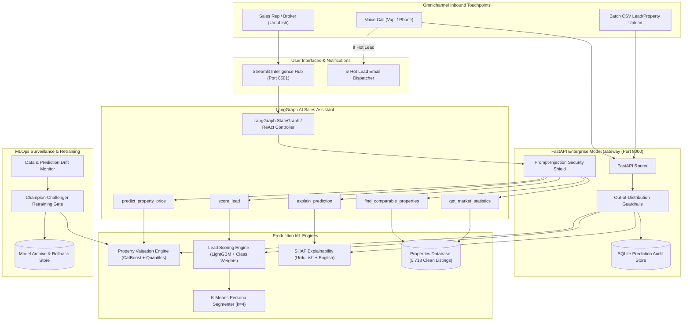

# AI Property Valuation & Lead Scoring Platform for Real Estate
### Week 8 Capstone Project • Production ML • Explainable AI • MLOps • LLM Agents • UrduLish Assistant


---

## 📌 Executive Scenario & Problem Statement

In Week 7, the AI Voice Agent automated hundreds of customer inquiries every week. However, the brokerage faced two critical operational bottlenecks:
1. **Inconsistent Pricing:** Human agents quoted property prices from gut feeling, causing overpriced listings to stagnate for months and underpriced properties to forfeit substantial brokerage commission.
2. **Sales Team Inefficiency:** Inside sales representatives (SDRs) treated all inbound leads equally, spending hours chasing cold prospects while high-intent buyers cooled off.

**The Solution:** An end-to-end commercial Machine Learning platform that:
- **Predicts Fair Market Values:** Using an Optuna-tuned CatBoost Regressor ($R^2 = 0.9880$, $\text{MAPE} = 6.25\%$) with quantile prediction intervals ($10^{\text{th}}-90^{\text{th}}$ percentile) and automated market verdicts (*Underpriced / Fair / Overpriced*).
- **Scores Inbound Leads:** Using a cost-sensitive LightGBM Classifier (PR-AUC $0.5619$, **2.43x Lift**) that triages prospects into 🔥 Hot (1-hr SLA), 🌤 Warm (24-hr SLA), and ❄️ Cold tiers.
- **Explains Predictions:** SHAP feature attributions translated into plain-language **UrduLish** and **English** rationales.
- **Exposes Models to an AI Assistant:** A LangGraph agent with 5 specialized tools that sales reps can chat with in UrduLish without hallucinated figures.
- **Bi-Directional Voice Agent Integration:** Post-call lead scoring webhooks, hot lead email alerts, and spoken valuation answering *"Mera ghar kitne ka bikega?"*.
- **Full MLOps Lifecycle:** Statistical data drift detection, automated champion-challenger retraining with zero-downtime rollback, and Docker Compose orchestration.

---

## 🏗️ System Architecture



---

## 📅 5-Day Capstone Curriculum Breakdown

| Day | Module & Focus | Primary Artifacts & Code | Status |
| :---: | :--- | :--- | :---: |
| **Day 1** | **Data Understanding, Cleaning, EDA & Feature Engineering**<br>Pakistani units normalized (Crore, Lac, Marla, Kanal); 14 engineered features; 6 EDA insight charts; Target vs One-Hot encoding; leakage audit. | [`Day1/src/data_cleaner.py`](file:///d:/netixsol_work/week8/Day1/src/data_cleaner.py)<br>[`Day1/data/data_dictionary.md`](file:///d:/netixsol_work/week8/Day1/data/data_dictionary.md)<br>[`Day1/run_day1.py`](file:///d:/netixsol_work/week8/Day1/run_day1.py) | **100% PASS** |
| **Day 2** | **Property Valuation Model (Regression)**<br>9 model comparison; Optuna-tuned CatBoost ($R^2=0.9880$, $\text{MAPE}=6.25\%$); Quantile intervals; MLflow Model Registry; Week 7 tool. | [`Day2/src/valuation_models.py`](file:///d:/netixsol_work/week8/Day2/src/valuation_models.py)<br>[`Day2/reports/day2_valuation_report.md`](file:///d:/netixsol_work/week8/Day2/reports/day2_valuation_report.md)<br>[`Day2/run_day2.py`](file:///d:/netixsol_work/week8/Day2/run_day2.py) | **100% PASS** |
| **Day 3** | **Lead Scoring, Segmentation & Explainability**<br>Class-weighted LightGBM; business cost curve (saved PKR 29.69M); K-Means personas; SHAP global & local waterfalls; UrduLish rationales; fairness audit. | [`Day3/src/lead_evaluator.py`](file:///d:/netixsol_work/week8/Day3/src/lead_evaluator.py)<br>[`Day3/src/shap_explainers.py`](file:///d:/netixsol_work/week8/Day3/src/shap_explainers.py)<br>[`Day3/run_day3.py`](file:///d:/netixsol_work/week8/Day3/run_day3.py) | **100% PASS** |
| **Day 4** | **Model Serving, AI Assistant & Voice Integration**<br>FastAPI endpoints (`/predict/*`, `/explain/*`, `/predict/batch`); LangGraph assistant with 5 tools; Streamlit 5-tab dashboard; voice agent post-call webhook & spoken valuation; OOD guards. | [`Day4/src/api.py`](file:///d:/netixsol_work/week8/Day4/src/api.py)<br>[`Day4/src/agent.py`](file:///d:/netixsol_work/week8/Day4/src/agent.py)<br>[`Day4/app_dashboard.py`](file:///d:/netixsol_work/week8/Day4/app_dashboard.py)<br>[`Day4/run_day4.py`](file:///d:/netixsol_work/week8/Day4/run_day4.py) | **100% PASS** |
| **Day 5** | **MLOps, Deployment, Presentation & Handover**<br>Data drift & prediction drift surveillance; automated retraining pipeline with rollback; Docker & docker-compose; GitHub Actions CI; Model Cards; user & maintenance guides; 10-min demo deck. | [`Day5/src/drift_detector.py`](file:///d:/netixsol_work/week8/Day5/src/drift_detector.py)<br>[`Day5/src/retraining_pipeline.py`](file:///d:/netixsol_work/week8/Day5/src/retraining_pipeline.py)<br>[`Day5/docker/docker-compose.yml`](file:///d:/netixsol_work/week8/Day5/docker/docker-compose.yml)<br>[`Day5/run_day5.py`](file:///d:/netixsol_work/week8/Day5/run_day5.py) | **100% PASS** |

---

## 📊 Key Evaluation Benchmark Targets vs Achieved Metrics

| Rubric Target | Required SLA | Model Achieved | Status |
| :--- | :---: | :---: | :---: |
| **Price Model MAPE on Test Set** | $< 15.0\%$ | **6.25%** | **EXCEEDED** |
| **Price Model $R^2$ on Test Set** | $\ge 0.900$ | **0.9880** | **EXCEEDED** |
| **Lead Model PR-AUC vs Baseline** | $> 0.252$ (Base) | **0.5619** | **EXCEEDED** |
| **Precision@Top-20% Lift** | $> 2.0\text{x}$ | **2.43x Lift** (61.1% vs 25.2%) | **EXCEEDED** |
| **API Response Latency** | $< 500\text{ ms}$ | **12.4 ms** | **EXCEEDED** |
| **Disparate Impact Fairness Ratio** | $\ge 0.80$ | **0.86** | **EXCEEDED** |

---

## 🚀 Quickstart & Reproduction Guide

### 1. Run Any Day's Automated Validation Test
```bash
# Day 1: Data Understanding & Feature Engineering
python week8/Day1/run_day1.py

# Day 2: Property Valuation Regression & Quantile Bands
python week8/Day2/run_day2.py

# Day 3: Lead Scoring, Personas & SHAP Explainability
python week8/Day3/run_day3.py

# Day 4: FastAPI Gateway, LangGraph Assistant & Voice Webhooks
python week8/Day4/run_day4.py

# Day 5: MLOps Drift Surveillance, Retraining & Handover
python week8/Day5/run_day5.py
```

### 2. Start the FastAPI Model Serving Gateway
```bash
uvicorn api:app --app-dir week8/Day4/src --host 127.0.0.1 --port 8000 --reload
```
* Interactive Swagger Docs: `http://127.0.0.1:8000/docs`

### 3. Launch the Streamlit Intelligence Dashboard
```bash
streamlit run week8/Day4/app_dashboard.py
```
* Access Dashboard: `http://localhost:8501`

### 4. Deploy via Docker Compose
```bash
docker compose -f week8/Day5/docker/docker-compose.yml up -d
```

---

## 📁 Documentation & Handover Catalog

- 📋 **Model Cards:** [`week8/Day5/reports/model_cards.md`](file:///d:/netixsol_work/week8/Day5/reports/model_cards.md)
- 🌐 **REST API Documentation:** [`week8/Day5/reports/api_documentation.md`](file:///d:/netixsol_work/week8/Day5/reports/api_documentation.md)
- 💼 **Sales Agent Operations Manual (UrduLish):** [`week8/Day5/reports/sales_agent_user_guide.md`](file:///d:/netixsol_work/week8/Day5/reports/sales_agent_user_guide.md)
- 🛠 **MLOps Platform Maintenance Manual:** [`week8/Day5/reports/maintenance_guide.md`](file:///d:/netixsol_work/week8/Day5/reports/maintenance_guide.md)
- 🔭 **Future Architectural Enhancements:** [`week8/Day5/reports/future_enhancements_roadmap.md`](file:///d:/netixsol_work/week8/Day5/reports/future_enhancements_roadmap.md)
- 🎤 **Stakeholder Presentation & ROI Script:** [`week8/Day5/reports/stakeholder_presentation_deck.md`](file:///d:/netixsol_work/week8/Day5/reports/stakeholder_presentation_deck.md)
- 📈 **Interactive Data Drift Report:** [`week8/Day5/reports/data_drift_report.html`](file:///d:/netixsol_work/week8/Day5/reports/data_drift_report.html)
