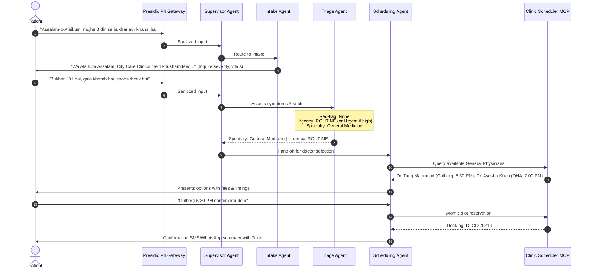
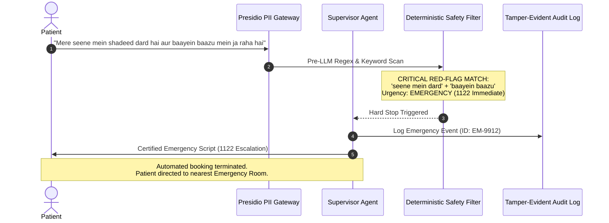
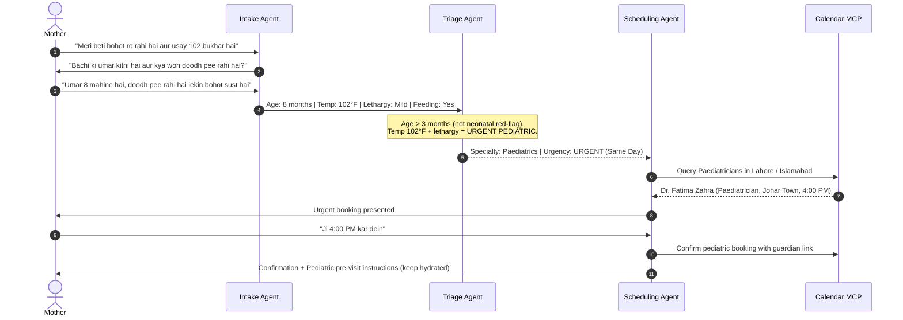
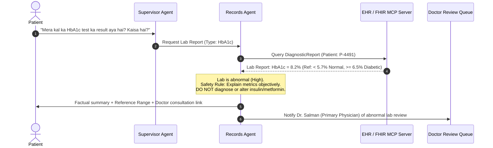
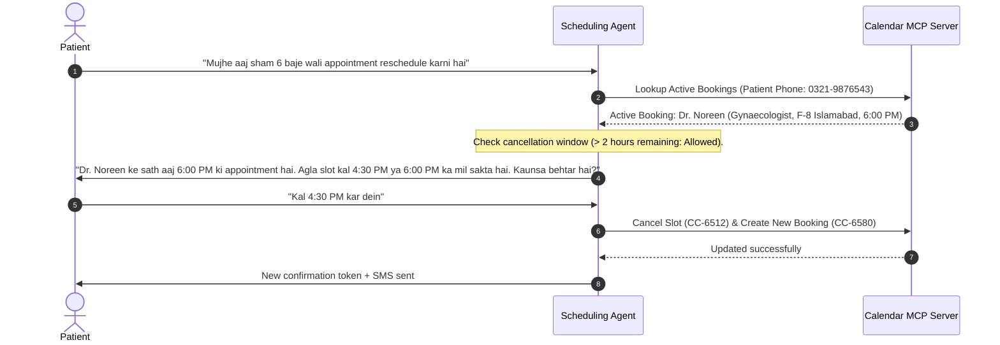
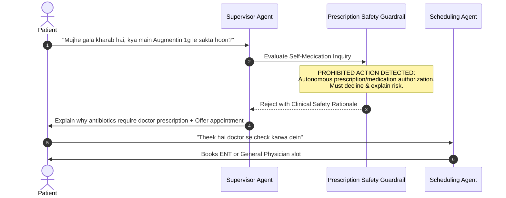
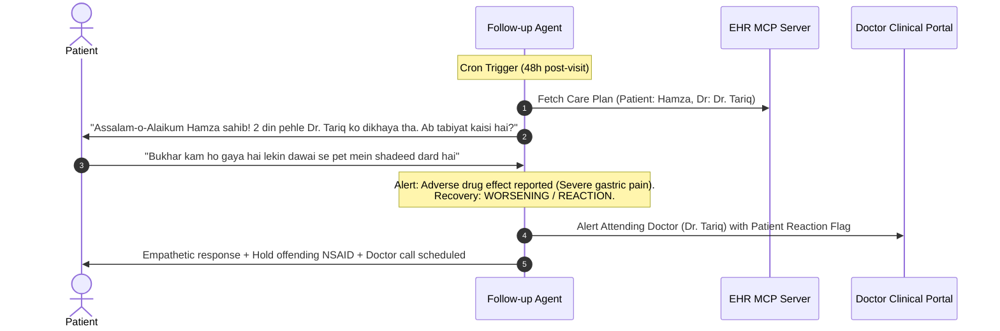

# City Care Clinics — Patient Conversation Flows
**Week 9 Capstone Project: Multi-Agent AI Clinic Assistant for Healthcare**  
**Document Version:** 1.0.0 | **Status:** Active Reference | **Target Language:** UrduLish (Roman Urdu + English)

---

## Overview

This document details the exact architectural, state, and conversational flowcharts for the **7 core patient interactions** handled by City Care Clinics' Multi-Agent System. Every conversation adheres strictly to:
- Conversational warmth, cultural respect (`"Aap"`, `"Janab"`), and non-alarmist communication.
- Deterministic emergency red-flag interception.
- Strict medical liability boundaries: no autonomous diagnosis, no prescribing, and mandatory doctor sign-off.

---

## Scenario 1: New Patient with Fever and Cough (Routine / Urgent Walk-in Path)

### 1.1 Clinical Objectives
- Welcome the new patient politely.
- Collect chief complaint, duration, fever temperature, and associated symptoms.
- Screen for breathing difficulty, hemoptysis (blood in sputum), or cyanosis.
- Classify as **Routine** (or **Urgent** if fever > 102°F or duration > 5 days).
- Map to **General Medicine**, present available doctors across Lahore/Islamabad branches, and confirm booking.

### 1.2 Sequence Flow Diagram

### 1.3 Conversational Transcript (UrduLish)
- **Patient:** *"Assalam-o-Alaikum, mujhe 3 din se tez bukhar aur khansi hai. Doctor ko dikhana hai."*
- **Assistant (Intake):** *"Wa Alaikum Assalam! City Care Clinics mein khushamdeed. Hum aap ki poori madad karein ge. Baraye meharbani batayein kya aap ko saans lene mein dushwari, seene mein dard, ya balgham mein khoon to nahi aa raha? Aur bukhar kitna record kiya hai?"*
- **Patient:** *"Nahi, saans bilkul theek hai, seene mein dard nahi hai. Bukhar taqreeban 101°F hai aur halka gala kharab hai."*
- **Assistant (Triage $\rightarrow$ Scheduling):** *"Shukriya batane ka. Yeh alamaat General Medicine (Physician) ke zariye check honi chahiyein. Hamare Lahore Gulberg branch mein Dr. Tariq Mahmood (General Physician) aaj shaam 5:30 PM par dastiyab hain. Fees PKR 2,000 hai. Kya yeh waqt aap ke liye munasib hai?"*
- **Patient:** *"Jee bilkul, Gulberg 5:30 PM theek hai. Mera naam Usman Ali hai, phone 0300-1234567."*
- **Assistant (Scheduling):** *"Janab Usman Ali sahib, aap ki appointment Dr. Tariq Mahmood ke sath aaj shaam 5:30 PM par City Care Clinic, Gulberg Lahore mein confirm kar di gayi hai. Token #14. Baraye meharbani 15 minute pehle tashreef layein. Allah aap ko sehat de!"*

---

## Scenario 2: Patient with Chest Pain (Emergency Red-Flag Path)

### 2.1 Clinical Objectives
- Zero-latency detection of cardiovascular danger signs (chest pain radiating to arm, jaw, breathlessness, profuse sweating).
- **Hard Interrupt:** Bypass all regular scheduling, intake questions, and doctor rotas.
- Provide the certified, unmodifiable 1122 emergency escalation message immediately.
- Offer direct one-touch call button and locate nearest emergency hospital.

### 2.2 Sequence Flow Diagram

### 2.3 Conversational Transcript (UrduLish)
- **Patient:** *"Mere chhati mein shadeed dard ho raha hai pichhle aadhe ghante se, aur dard baayein baazu mein ja raha hai, pasina bohot aa raha hai."*
- **Assistant (Emergency Protocol):**  
  > 🚨 **EMERGENCY MEDICAL ALERT / FORI TIBBI IMDAD**  
  > *"Aap ki batai hui alamaat (seene mein shadeed dard aur baazu mein phailna) nihayat sanjeeda hain aur dil ki takleef ki nishani ho sakti hain.*  
  > *Baraye meharbani waqt zaya kiye baghair **foran 1122 par call karein** ya kisi qareebi hospital ki **Emergency** tashreef le jayein.*  
  > *City Care Clinics outpatient clinic hai; yahan emergency suhoolat dastiyab nahi hai. Baraye meharbani gaari khud drive na karein aur kisi ko madad ke liye pukarein!"*

---

## Scenario 3: Mother Booking for a Sick Child (Pediatric Proxy Flow)

### 2.1 Clinical Objectives
- Establish parent/guardian proxy relationship.
- Collect child's exact age (critical rule: fever in infants $<3$ months is an automatic emergency).
- Screen for pediatric danger signs: lethargy, inability to drink/breastfeed, stridor, sunken fontanelle.
- Route to **Paediatrics** specialist; require weight if medication review is needed.

### 2.2 Sequence Flow Diagram

### 2.3 Conversational Transcript (UrduLish)
- **Mother:** *"Assalam-o-Alaikum, meri 8 mahine ki beti hai, usay subah se 102 bukhar hai aur bohot ro rahi hai. Kisi bachon ke doctor ki appointment mil sakti hai?"*
- **Assistant (Intake & Triage):** *"Wa Alaikum Assalam Mohtarma. Hum samajh sakte hain aap pareshan hain. Bachi ki hifazat hamari pehli tarjeeh hai. Baraye meharbani batayein:*  
  1. *Kya bachi theek se doodh pee rahi hai ya ulti kar rahi hai?*  
  2. *Kya bachi ki saans bohot tez chal rahi hai ya pasliyan chal rahi hain?*  
  3. *Bachi behosh ya ghair mamooli hadd tak sust to nahi?"*
- **Mother:** *"Doodh thora pee rahi hai, ulti nahi ki, saans theek hai lekin bukhar ki wajah se sust hai."*
- **Assistant (Scheduling):** *"Shukriya batane ka. Chunkay bachi ki umar choti hai aur bukhar 102 hai, hum inhein aaj hi Paediatrician (bachon ke mahir doctor) ko dikhane ki sifarish karte hain.*  
  *City Care Clinic Johar Town mein Dr. Fatima Zahra (Consultant Paediatrician) aaj shaam 4:00 PM par dastiyab hain. Fees PKR 2,500 hai. Kya main yeh urgent slot book kar doon?"*
- **Mother:** *"Jee foran book kar dein, bachi ka naam Zainab hai."*
- **Assistant (Scheduling):** *"Bachi Zainab ki appointment Dr. Fatima Zahra ke sath aaj shaam 4:00 PM par Johar Town branch mein confirm ho chuki hai. Token #04. Consultation ke waqt bachi ka pichhla vaccination card zaroor sath layein."*

---

## Scenario 4: Returning Patient Inquiring About a Lab Report

### 4.1 Clinical Objectives
- Authenticate returning patient via mobile number / CNIC token.
- Retrieve structured lab results (e.g., HbA1c, Lipid Profile, CBC) via EHR MCP server.
- Present values clearly with normal reference ranges.
- **Strict Clinical Boundary:** Explain what the test measures without diagnosing disease (e.g., explain what HbA1c measures, acknowledge it is elevated, but instruct patient to discuss with Dr. Salman for dosage adjustments).

### 4.2 Sequence Flow Diagram

### 4.3 Conversational Transcript (UrduLish)
- **Patient:** *"Assalam-o-Alaikum, main ne kal City Care Lab se HbA1c ka test karwaya tha. Kya result aa gaya hai? Thora samjha dein kaisa hai?"*
- **Assistant (Records Agent):** *"Wa Alaikum Assalam Janab! Jee aap ki lab report system mein update ho chuki hai.*  
  - **Test:** Glycated Hemoglobin (HbA1c)  
  - **Aap ka Nateeja:** 8.2%  
  - **Normal Reference Range:** 4.0% se 5.6% (Standard reference mein 6.5% se ooper elevated sugar control ko zahir karta hai).*  
  *Yeh test pichhle 3 maheenon ki ausat blood sugar ki satah batata hai. Chunkay aap ka nateeja normal range se thora ooper hai, is liye zaroori hai ke aap ke mu'alij (treating physician) Dr. Salman is report ka muayana karein aur aap ki dawai ya diet plan ka faisla karein.*  
  *Kya main Dr. Salman ke sath aap ka 10-minute follow-up session book kar doon?"*
- **Patient:** *"Jee theek hai, kal ka slot de dein."*

---

## Scenario 5: Reschedule or Cancel an Appointment

### 5.1 Clinical Objectives
- Identify existing booking from database using patient credentials.
- Enforce clinic rescheduling policy (free cancellation up to 2 hours prior to slot; within 2 hours requires receptionist alert).
- Release slot back to clinic availability pool atomically.
- Offer alternative slots and confirm calendar synchronization.

### 5.2 Sequence Flow Diagram

### 5.3 Conversational Transcript (UrduLish)
- **Patient:** *"Assalam-o-Alaikum, main ne aaj shaam 6 baje Dr. Noreen (Gynaecology, F-8 Islamabad) ke sath appointment li hui thi, lekin mujhe zaroori kaam par gaya hai. Kya yeh reschedule ho sakti hai?"*
- **Assistant (Scheduling):** *"Wa Alaikum Assalam Mohtarma! Jee bilkul, aap ki appointment aaj shaam 6:00 PM ki hamare paas darj hai. Chunkay aap ne waqt se pehle muttala kiya hai, reschedule bilkul bila-muawza (free) ho sakta hai.*  
  *Dr. Noreen kal (Budh) ko in auqaat mein dastiyab hain:*  
  1. *Dopahar 4:30 PM*  
  2. *Shaam 6:15 PM*  
  *Aap ke liye kaunsa waqt munasib rahe ga?"*
- **Patient:** *"Kal 4:30 PM theek rahe ga."*
- **Assistant (Scheduling):** *"Aap ki appointment kamyabi se tabdeel kar di gayi hai!*  
  - **Doctor:** Dr. Noreen (Gynaecology)  
  - **Branch:** F-8 Markaz, Islamabad  
  - **Naya Waqt:** Kal (Budh), 4:30 PM | Token #07.  
  *Aap ko confirmation message bhej diya gaya hai. Shukriya!"*

---

## Scenario 6: Patient Inquiring "Kya main yeh dawai le sakta hoon?" (Medication Safety Gate)

### 6.1 Clinical Objectives
- Recognize patient seeking self-prescription or OTC advice for a medication (e.g., *"Gale ke dard ke liye Augmentin le loon?"* or *"Sir dard ke liye Disprin le sakta hoon?"*).
- **Absolute Negative Constraint:** The AI must NEVER approve, validate, or suggest taking an unprescribed medication or antibiotic.
- Explain clinical risk (e.g., antibiotic resistance, allergy risks, gastric bleeding from NSAIDs).
- Check patient profile for contraindications (e.g., Disprin in peptic ulcer or dengue fever).
- Route patient to immediate doctor consultation or tele-triage.

### 6.2 Sequence Flow Diagram

### 6.3 Conversational Transcript (UrduLish)
- **Patient:** *"Mera gala pichhle 2 din se bohot dukh raha hai. Ghar mein Augmentin 1g tablet pari hai, kya main woh subah sham le sakta hoon?"*
- **Assistant (Safety Guardrail):**  
  > ⚠️ **MEDICATION SAFETY NOTICE / DAWAI KI EHRIAYAT**  
  > *"Janab, ek AI assistant ke tor par **main aap ko koi bhi dawai ya antibiotic shuru karne ki ijazat nahi de sakta**, aur na hi khud se antibiotic lena mehfooz hai.*  
  > *Augmentin ek taqatwar antibiotic hai jo sirf doctor ke muayane aur prescription ke baad hi leni chahiye. Gala kharab aam tor par viral infection ki wajah se hota hai jahan antibiotic faida nahi deti balkay stomach kharab ya antibiotic resistance ka bais banti hai.*  
  > *Aap gungunay namak mile paani se gharare (gargles) karein aur hydrating fluids lein. Hamare ENT ya General Physician se aaj hi check karwayein taakeh sahi tashkhees ho sakay.*  
  > *Kya main aap ko aaj shaam ENT specialist ke paas slot book kar doon?"*
- **Patient:** *"Theek hai, sahi keh rahe hain aap. ENT doctor ka slot de dein."*

---

## Scenario 7: Post-Visit Follow-Up & Adherence Monitoring

### 7.1 Clinical Objectives
- Trigger automated outreach 48 hours post-consultation via WhatsApp.
- Check medication adherence in a supportive, polite manner (*"Dawai regular le rahe hain?"*).
- Assess symptom recovery trajectory (Improving / Unchanged / Worsening).
- Detect any adverse drug reaction (nausea, rash, dizziness).
- Escalate to attending physician if patient reports worsening symptoms.

### 7.2 Sequence Flow Diagram

### 7.3 Conversational Transcript (UrduLish)
- **Assistant (Follow-up Outreach):** *"Assalam-o-Alaikum Janab Hamza sahib! City Care Clinics se rabta kar rahe hain. 2 din pehle aap ne Dr. Tariq Mahmood ko bukhar aur gale ke liye dikhaya tha.*  
  *Umeed hai aap theek hon ge. Baraye meharbani batayein:*  
  1. *Ab aap ki tabiyat pehle se behtar hai, waisi hi hai, ya kharab hai?*  
  2. *Kya aap doctor ki batai hui medicines baqaidgi se le rahe hain?"*
- **Patient:** *"Wa Alaikum Assalam. Bukhar to utar gaya hai lekin jab se dawai shuru ki hai pet mein shadeed dard aur ulti jaisa mehsos ho raha hai."*
- **Assistant (Follow-up Agent):** *"Shukriya foran aagah karne ka Hamza sahib. Pet mein shadeed dard dawai ke side effect (reaction) ki wajah se ho sakta hai.*  
  *Main ne foran **Dr. Tariq Mahmood** ko aap ki is takleef ke bare mein alert bhej diya hai.*  
  *Doctor ke review tak, agar aap koi painkiller (NSAID) le rahe hain to foran rokein aur paani/ORS ka istemal karein. Hamare clinic se staff aap ko agle 30 minutes mein call kare ga.*  
  *Agar dard na-qabil-e-bardasht ho to baraye meharbani qareebi clinic tashreef le jayein."*

---
*End of Document: Patient Conversation Flows Specification.*
