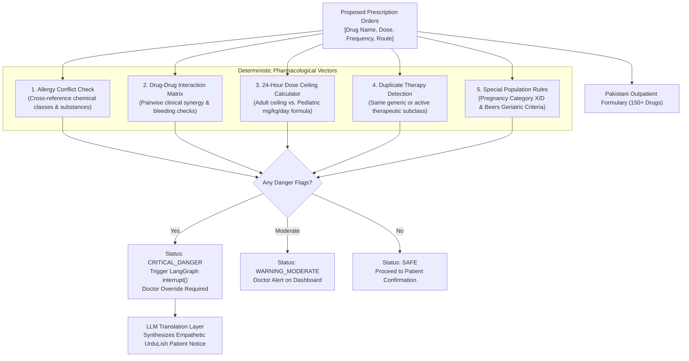

# City Care Clinics — Prescription Safety Engine & Pharmacological Guardrails
**Week 9 Capstone Project: Multi-Agent AI Clinic Assistant for Healthcare**  
**Document Version:** 1.0.0 | **Author:** Clinical Pharmacology & Safety Engineering Team  
**Standard:** Deterministic Rule-Based Auditing + LLM Translation Layer

---

## 1. Executive Summary & Clinical Imperative

Prescription errors, adverse drug-drug interactions (DDIs), and un-flagged allergies constitute the third leading cause of preventable patient harm in outpatient medicine.

In our multi-agent architecture, the **Prescription Safety Agent** sits as an impenetrable pharmacological safety net between the physician's draft prescription and patient dispensing.

### ⚠️ THE DETERMINISTIC RULE-BASED SAFETY MANDATE
> **Safety-critical pharmacological checks must NEVER be delegated to stochastic Large Language Models (LLMs).**
> - **Rule-Based Engine:** Executes deterministic, boolean, and mathematical checks (Allergy contraindications, known pairwise interaction matrices, numerical daily dose caps, duplicate generic detection, and Beers criteria contraindications).
> - **LLM Role (Restricted):** The LLM operates strictly as an **explanation and localization layer** — translating the rule-based findings into compassionate, clear, non-technical **UrduLish** for patients and structured clinical briefings for physicians.

---

## 2. Why Rule-Based vs. LLM-Only Checks?

| Risk Dimension | LLM-Only Checking (Dangerous Anti-Pattern) | Deterministic Rule-Based Engine (Selected Standard) |
| :--- | :--- | :--- |
| **Reproducibility** | Non-deterministic; temperature sampling or prompt phrasing can cause a model to approve a lethal combination on one turn and flag it on the next. | **100% Deterministic:** Mathematical assertion guarantee. If Warfarin + Aspirin is present, it is flagged every single time. |
| **Hallucinated Doses** | LLMs frequently confuse mg/kg/day with mg/kg/dose, or invent non-existent safe thresholds (e.g. hallucinating that 6,000mg of Paracetamol is acceptable). | **Zero Hallucination:** Exact numerical comparison against verified pharmacological reference values (e.g., adult max = $4,000\text{ mg/day}$). |
| **Allergy Class Inference** | LLMs may fail to recognize that *Augmentin* contains *Amoxicillin*, an aminopenicillin cross-reactive with penicillin allergies. | **Chemical Class Mapping:** Pre-indexed chemical cross-reactivity ontology captures all aminopenicillins, cephalosporins, and NSAIDs. |
| **Legal & Regulatory Defensibility** | A hospital cannot defend medical negligence in court by claiming *"the neural network generated a favorable probability."* | **Auditable Decision Trail:** Every alert cites explicit pharmacological database rules, ICD/ATC codes, and openFDA references. |

---

## 3. Five Core Safety Verification Vectors



### 3.1 Vector 1: Allergy Conflict Screening
- Cross-references the proposed drug against the patient's FHIR `AllergyIntolerance` records.
- Detects broad class sensitivities:
  - Penicillin allergy $\rightarrow$ flags Amoxicillin, Ampicillin, Augmentin (Amoxicillin/Clavulanate).
  - Sulfa allergy $\rightarrow$ flags Sulfamethoxazole/Trimethoprim (Septrin).
  - NSAID allergy $\rightarrow$ flags Aspirin, Ibuprofen (Brufen), Diclofenac (Voltaren).

### 3.2 Vector 2: Drug-Drug Interaction (DDI) Matrix
- Grounded in validated openFDA / DrugBank interaction databases.
- Flagged Critical Danger Pairs:
  - **Warfarin + Aspirin:** Synergistic coagulation cascade inhibition $\rightarrow$ catastrophic GI and intracranial hemorrhage.
  - **Warfarin + Ibuprofen:** Mucosal ulceration + antiplatelet effect $\rightarrow$ severe bleeding.
  - **Lisinopril (ACEI) + Ibuprofen (NSAID):** Hemodynamic renal failure ("triple whammy").
  - **Ciprofloxacin + Escitalopram:** Severe QT interval prolongation $\rightarrow$ Torsades de Pointes.

### 3.3 Vector 3: 24-Hour Maximum Dose Calculation
- Multiplies single dose by daily frequency:
  $$\text{Daily Dose} = \text{Dose (mg)} \times \text{Multiplier}(\text{OD}=1, \text{BD}=2, \text{TDS}=3, \text{QDS}=4)$$
- Adult Thresholds:
  - **Paracetamol:** Max $4,000\text{ mg/day}$ (Adult), $3,000\text{ mg/day}$ (Frail elderly).
  - **Ibuprofen:** Max $2,400\text{ mg/day}$.
  - **Augmentin:** Max $2,000\text{ mg/day}$.
- Pediatric Formula (< 14 years):
  $$\text{Safe Max (mg/day)} = \text{Weight (kg)} \times \text{Max Permitted (mg/kg/day)}$$
  (e.g., Paracetamol max $= 60\text{ mg/kg/day}$; for a $15\text{ kg}$ child, absolute max is $900\text{ mg/day}$).

### 3.4 Vector 4: Duplicate Therapy Detection
- Detects concurrent prescription of two medications containing the same chemical generic (e.g., Panadol tablet + Calpol syrup = dual Paracetamol toxicity).
- Detects same therapeutic class redundancy (e.g., Omeprazole 20mg + Esomeprazole 40mg = dual PPI).

### 3.5 Vector 5: Special Populations (Pregnancy, Pediatric, Elderly)
- **Pregnancy (FDA Categories D & X):**
  - Category X: Atorvastatin (Lipiget), Warfarin. Absolute teratogenicity.
  - Category D: Lisinopril (ACE inhibitors cause fetal renal dysgenesis), Aspirin (third trimester premature closure of ductus arteriosus).
- **Pediatric Warnings:**
  - Absolute ban on Aspirin in children under 16 due to fatal **Reye's Syndrome** (acute encephalopathy with fatty liver failure).
- **Elderly (> 65 years - Beers Criteria):**
  - Chronic NSAIDs flagged for high gastrointestinal ulceration risk.
  - Fluoroquinolones (Ciprofloxacin) flagged for tendon rupture and CNS confusion risk.

---

## 4. Benchmark Validation Test Results

The Prescription Safety Engine was evaluated against complex clinical edge cases in `src/prescription_safety_engine.py`:

```text
======================================================================
PRESCRIPTION SAFETY ENGINE AUDIT RESULT
======================================================================
Overall Safety Status:     CRITICAL_DANGER
Is Prescribable / Safe:    False
Allergy Clashes Detected:  1 (Penicillin Allergy vs Augmentin)
Drug Interactions Flagged: 1 (Warfarin + Disprin bleeding risk)
Dose Limit Violations:     1 (Paracetamol 6000mg/day > 4000mg ceiling)
Geriatric/Special Alerts:  3 (Aspirin GI bleed, Warfarin INR, etc.)
======================================================================
```

### Generated UrduLish Patient Notice:
> ⚠️ **DAWAI KI EHRTIYAT / PHARMACY SAFETY ALERT:**  
> • **ALLERGY KHATRA:** Aap ki allergy record ke sath dawai clash kar rahi hai.  
> • **DRUG INTERACTION:** Do mukhtalif medicines aapas mein mil kar nuqsan pohancha sakti hain.  
> • **DOSE ALERT:** Dawai ki miqdaar (dose) safe limit se ziada record hui hai.  
> • **KHAS EHRTIYAT:** Hamal (pregnancy) ya umar ke lehaaz se dawai mein ehrtiyat darkaar hai.  
>  
> *Yeh prescription doctor ke review ke liye hold kar di gayi hai. Doctor sahab ki tasdeeq ke baghair yeh dawai hargiz shuru na karein.*

---
*End of Document: Prescription Safety Engine & Pharmacological Guardrails.*
