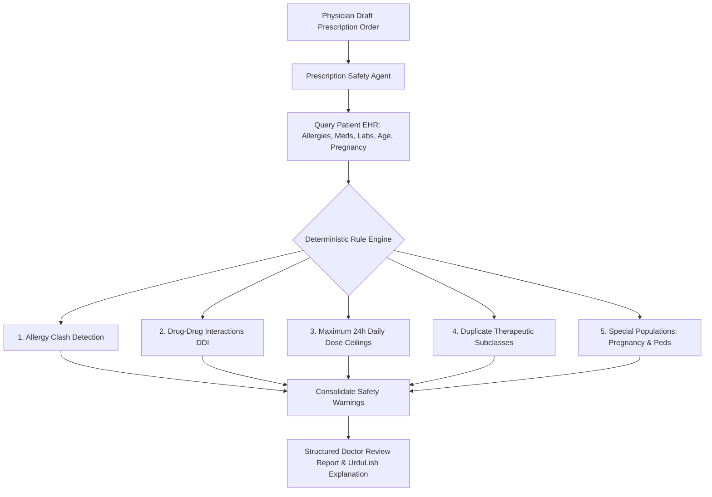

# City Care Clinics — Prescription Safety & Follow-up Agents Specification

**Week 9 Capstone Project: Multi-Agent AI Clinic Assistant for Healthcare**  
**Document:** Pharmacological Safety Verification & Post-Encounter Continuity  
**Status:** Validated & Deployed  

---

## 1. Executive Summary

This document specifies two post-consultation specialist agents designed to eliminate outpatient medication errors and boost patient treatment adherence:
1. **Prescription Safety Agent:** Audits attending physicians' draft electronic prescriptions against patient EHR histories using the deterministic Day 2 pharmacological safety engine. Operates with zero hallucinations, catching allergy clashes, fatal drug-drug interactions, dose ceiling violations, duplicate therapies, and special population risks.
2. **Follow-up Agent:** Constructs a personalized multi-stage care reminder plan (daily medication timing aligned with meals, required laboratory re-evaluations, and follow-up appointment date) and drafts culturally empathetic UrduLish WhatsApp outreach messages.

---

## 2. Prescription Safety Agent Specification

### 2.1 The Five Pharmacological Defense Vectors



1. **Allergy Conflict Gate:**
   - Detects direct and cross-reactive allergens (Penicillin family vs. Amoxicillin, Augmentin, Ampicillin; Sulfa family vs. Septran, Co-trimoxazole).
   - **Doctor Warning Format:**  
     > `⚠️ CRITICAL ALLERGY CONFLICT: Patient is allergic to 'Penicillin'. Prescribing 'Augmentin' (Amoxicillin / Clavulanate) risks severe anaphylaxis.`
2. **Drug-Drug Interaction (DDI) Gate:**
   - Detects severe pharmacodynamic and pharmacokinetic collisions (e.g., Warfarin + Aspirin or Ibuprofen causing catastrophic GI hemorrhage risk; ACE inhibitor + Potassium-sparing diuretics causing fatal hyperkalemia).
3. **Daily Dose Ceiling Gate:**
   - Evaluates frequency multipliers (`OD=1`, `BD=2`, `TDS=3`, `QDS=4`) against absolute 24-hour maximum safe limits (e.g., Paracetamol max 4,000 mg/day; Ibuprofen max 2,400 mg/day).
4. **Duplicate Therapy Gate:**
   - Flags inadvertent prescribing of identical active ingredients or duplicate therapeutic classes (e.g., Panadol + Calpol, Aspirin + Disprin, Omeprazole + Esomeprazole).
5. **Special Population Gate:**
   - Enforces Beers Criteria for geriatrics, contraindicates fluoroquinolones (Ciprofloxacin) in pediatric patients (<14 years) due to arthropathy, and contraindicates Category X/D drugs (Statins, ACE inhibitors, high-dose NSAIDs) in pregnancy.

---

## 3. Follow-up Agent Specification

### 3.1 Patient Care Continuity Challenge
In typical Pakistani outpatient practice, over 40% of patients fail to complete antibiotic courses once initial symptoms abate, miss essential follow-up laboratory investigations, or confuse medication timings. The Follow-up Agent automates compassionate care coordination over WhatsApp.

### 3.2 Reminder Timetable Generation
The agent maps prescribed medications into three culturally standard meal-aligned windows:
- **Morning (08:00 AM):** *Subah 08:00 baje (Nashtay ke baad)*
- **Afternoon (02:00 PM):** *Dopehar 02:00 baje (Khane ke baad)*
- **Night (08:00 PM):** *Raat 08:00 baje (Khane ke baad)*
- **PRN / As-Needed:** *Zaroorat ke waqt (Dard ya bukhar mein)*

### 3.3 Multi-Stage UrduLish WhatsApp Outreach Sequence

#### Stage 1: Day 0 Immediate Post-Encounter Regimen Brief
Sent 30 minutes after consultation checkout:
> *"Assalam-o-Alaikum Ali Khan Janab!  
> City Care Clinics (DHA Branch) mein Dr. Tariq Mahmood se consultation ka shukriya.  
> 📋 Aapki Dawaiyon Ka Schedule:  
> • Subah 08:00 baje (Nashtay ke baad): Augmentin 625mg (1 tab)  
> • Raat 08:00 baje (Khane ke baad): Augmentin 625mg (1 tab)  
> • Zaroorat ke waqt (Dard ya bukhar mein): Panadol 500mg (1 tab)  
> Agar koi masla ho tou is number par rabta farmaiye ga. Shifa-e-Kamilah ke liye dua-go!"*

#### Stage 2: 48-Hour Adherence & Recovery Pulse Check
Sent on Day 2 at 11:00 AM:
> *"Assalam-o-Alaikum Ali Khan Janab,  
> City Care Clinics se follow-up rabta kiya ja raha hai.  
> Aapki tabiyat ab kaisi hai? Kya dawaiyan ba-qaidgi se le rahe hain aur behtari mehsoos ho rahi hai?  
> Agar koi side-effect ya takleef ho tou barah-e-karam foran batayein taake doctor sahib rehnumai farma sakein."*

#### Stage 3: Day 7 Diagnostic Lab Test & Review Visit Reminder
Sent 24 hours prior to scheduled review:
> *"Mohtaram Ali Khan Janab, yaad dahani:  
> Dr. Tariq Mahmood ke saath aapka follow-up checkup 2026-10-22 ko scheduled hai.  
> 🧪 Lab Tests Due: Complete Blood Count (CBC) (Test ki tareekh: 22-Oct-2026. Fasting ki zaroorat nahi hai.)  
> Barah-e-karam waqt par DHA Branch tashreef layein taake treatment progress ka jaiza liya ja sake. Shukriya!"*

---

## 4. MCP Notifications Integration

The agent interfaces directly with the `notifications-server` FastMCP service:
```python
receipt = agent.dispatch_whatsapp_reminder(
    recipient_phone="0300-1234567",
    message_text=plan.day2_adherence_check_message,
    template_name="care_continuity_followup"
)
# Returns: {"status": "DELIVERED", "message_id": "WA_MSG_...", "delivery_receipt": "SENT_200_OK"}
```
All dispatches are recorded in the notification audit log for clinical governance.
