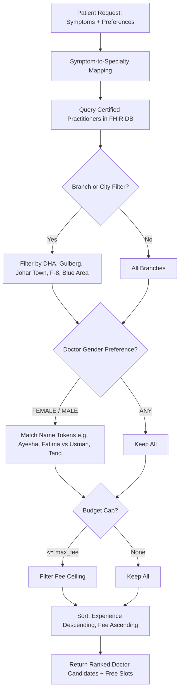

# City Care Clinics — Scheduling Specialist Agent Specification

**Week 9 Capstone Project: Multi-Agent AI Clinic Assistant for Healthcare**  
**Document:** Scheduling Agent Architecture & Protocol Specification  
**Status:** Validated & Active  

---

## 1. Executive Overview

The **Scheduling Specialist Agent** is an autonomous booking coordination agent responsible for matching patient clinical needs with the appropriate specialist doctor across City Care Clinics' 5 outpatient branches in Lahore and Islamabad.

It strictly adheres to core medical practice invariants:
1. **Never Book in the Past:** Compares requested consultation timestamps against reference clinic time (`2026-10-08 12:00:00+05:00`). Any past slot is rejected with `PAST_DATE_ERROR`.
2. **Never Double-Book:** Atomic slot collision checking prevents two patients from booking the same doctor in the same 15-minute consultation window (`SLOT_CONFLICT`).
3. **Clinical Specialty Routing:** Translates unstructured patient symptoms in English or UrduLish into certified medical specialties before booking.
4. **Preference-Driven Matching:** Filters by doctor gender, languages spoken (Urdu, Punjabi, English), physical clinic branch, and consultation fee ceiling.
5. **Standard Calendar Integration:** Outputs RFC 5545 / Google Calendar API v3 Event payloads with start/end timestamps, location, attendee profiles, and alerts.

---

## 2. Clinical Symptom to Specialty Routing Matrix

| Symptom Category (English & UrduLish Keywords) | Target Medical Specialty | Rationale & Examples |
|---|---|---|
| **Skin / Jild / Khujli** (`rash`, `khujli`, `acne`, `dana`, `jild`, `eczema`, `fungal`, `hair fall`) | **Dermatology** | Outpatient dermatological conditions requiring topical/systemic management. |
| **Ear, Nose, Throat / Gala** (`kaan`, `ear`, `gala`, `throat`, `naak`, `tonsil`, `sinus`, `hearing`) | **ENT** | Otolaryngology cases (otitis media, tonsillitis, sinusitis). |
| **Heart / Dil / BP** (`dil`, `chest pain`, `seenay`, `palpitation`, `dharkan`, `blood pressure`, `high bp`) | **Cardiology** | Cardiorespiratory complaints requiring ECG/Echo evaluation. |
| **Obstetrics & Women's Health** (`hamal`, `pregnancy`, `pregnant`, `period`, `haiz`, `pelvic`, `gynae`) | **Gynaecology** | Antenatal care, maternal wellness, hormonal and menstrual cycles. |
| **Pediatric / Bachay** (`bacha`, `bachi`, `baby`, `child`, `infant`, `newborn`, `vaccination`, `<14 yrs`) | **Paediatrics** | Childhood infections, immunization, growth milestones. |
| **General / Flu / Sugar** (`fever`, `bukhar`, `cough`, `flu`, `sugar`, `diabetes`, `kamzori`, `stomach`) | **General Medicine** | Primary care, chronic non-communicable diseases, acute uncomplicated infections. |

---

## 3. Doctor Preference Matching Algorithm

The matching algorithm executes multi-tiered filtering:



---

## 4. Anti-Double-Booking & Anti-Past-Date Invariants

### 4.1 Past Date Invariant
```python
if slot_dt < self.reference_now:
    return BookingResult(
        status="PAST_DATE_ERROR",
        message=f"Cannot book appointments in the past. Requested {slot_datetime}, current is {reference_now}."
    )
```

### 4.2 Slot Collision Invariant
```python
collision = session.query(AppointmentModel).filter_by(
    practitioner_id=request.doctor_id,
    slot_datetime=request.slot_datetime,
    status="booked"
).first()

if collision:
    return BookingResult(
        status="SLOT_CONFLICT",
        message=f"Slot '{request.slot_datetime}' with {doc.name} is already booked. Double-booking prevented."
    )
```

---

## 5. Google Calendar v3 Event Payload Specification

Upon confirmed booking, the agent synthesizes the following JSON payload:

```json
{
  "kind": "calendar#event",
  "id": "gcal_apt_bk_8f29d10e",
  "status": "confirmed",
  "htmlLink": "https://calendar.google.com/calendar/event?eid=...",
  "summary": "Consultation: Dr. Bilal Aslam (Paediatrics) - Valued Patient",
  "description": "City Care Clinics Outpatient Consultation\nBooking ID: APT_BK_8F29D10E\nToken Number: #2\nDoctor: Dr. Bilal Aslam (Paediatrics)\nChief Complaint: Child has 102 fever\nConsultation Fee: PKR 3000\nPlease arrive 10 minutes prior to your token slot.",
  "location": "City Care Clinics — DHA Branch, Sector Y, Commercial Phase 3, DHA Lahore",
  "start": {
    "dateTime": "2026-10-15T17:00:00+05:00",
    "timeZone": "Asia/Karachi"
  },
  "end": {
    "dateTime": "2026-10-15T17:15:00+05:00",
    "timeZone": "Asia/Karachi"
  },
  "attendees": [
    {"displayName": "Valued Patient", "responseStatus": "accepted"},
    {"displayName": "Dr. Bilal Aslam", "responseStatus": "accepted"}
  ],
  "reminders": {
    "useDefault": false,
    "overrides": [
      {"method": "popup", "minutes": 60},
      {"method": "popup", "minutes": 1440}
    ]
  },
  "iCalUID": "APT_BK_8F29D10E@citycareclinics.pk"
}
```

---

## 6. UrduLish Dialogue Interface

The agent communicates using compassionate and culturally attuned Pakistani UrduLish:

### Proactive Slot Proposal:
> *"Dr. Ayesha (Paediatrics) kal subah 10:30 baje DHA branch mein available hain. Kya main confirm kar doon?"*

### Booking Confirmation:
> *"Aapki appointment Dr. Bilal Aslam (Paediatrics) ke saath 2026-10-15 17:00 ko City Care Clinics — DHA Branch mein confirm ho chuki hai. Aapka Token #2 hai. Consultation fee PKR 3000 hai. Shukriya!"*

### Conflict / Error Message:
> *"Maaf kijiye ga, yeh slot (2026-10-15 17:00) pehle se booked hai. Barah-e-karam doosra waqt muntakhib karein."*
