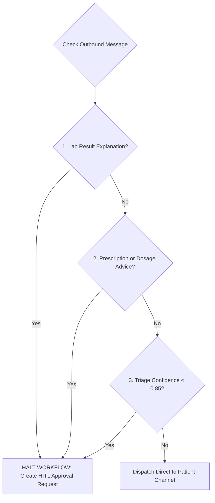

# City Care Clinics — Human-in-the-Loop (HITL) Doctor Approval Protocol

**Week 9 Capstone Project: Multi-Agent AI Clinic Assistant for Healthcare**  
**Document:** Day 4 Task 3 — Physician Oversight & Clinical Guardrails Specification  
**Status:** Validated & Active  

---

## 1. Executive Summary & Core Principle

In medical practice, automated AI recommendations can assist healthcare professionals but must never practice medicine autonomously. At City Care Clinics, the **Human-in-the-Loop (HITL) Guardrail** ensures that all sensitive clinical advice, prescription guidance, and diagnostic interpretations require physician sign-off before reaching a patient.

---

## 2. Mandatory Interrupt Triggers

The supervisor graph evaluates three mandatory interrupt triggers:



1. **Trigger 1 — Laboratory Diagnostic Explanations (`LAB_RESULT_EXPLANATION`):**
   - Triggered whenever an outgoing message attempts to explain, contextualize, or interpret diagnostic lab observations (e.g. elevated HbA1c, abnormal CBC, elevated liver enzymes).
2. **Trigger 2 — Prescription & Medication Directives (`PRESCRIPTION_MESSAGE`):**
   - Triggered whenever an outgoing message suggests initiating, modifying, or scheduling pharmacological drugs.
3. **Trigger 3 — Low-Confidence Triage Decisions (`LOW_CONFIDENCE_TRIAGE`):**
   - Triggered when clinical triage confidence score falls below **0.85**, or when ambiguous symptoms make clinical specialty classification uncertain.

---

## 3. Physician Review Actions

When an interrupt occurs, the pending item enters the attending physician's oversight queue (`hitl_pending_approvals.json`). The doctor has three actions:

### Action A: Approve As Is
- **Behavior:** The physician reviews the AI draft, confirms clinical appropriateness, and approves dispatch without modification.
- **Result:** The graph resumes from checkpoint and dispatches the message to the patient's channel.

### Action B: Edit & Approve
- **Behavior:** The physician identifies a clinical oversight or desires refined wording, modifies the draft message in the dashboard, adds internal notes, and submits.
- **Result:** The graph overrides `final_patient_response` with `doctor_edited_message` and logs the modification in the audit trail.
- **Example in Live Benchmark:**
  - *Original AI Draft:* `"Aapka HbA1c 8.2% hai jo high hai. Metformin 500mg shuru karein."`
  - *Doctor Note:* `"Do not prescribe Metformin over chat without checking renal function."`
  - *Doctor Edited Dispatched Text:* `"Aapka HbA1c 8.2% aya hai jo elevated hai. Barah-e-karam kal clinic mein Dr. Tariq se milien taake dawai prescribe ki ja sake."`

### Action C: Reject & Route to Clinic
- **Behavior:** The physician deems the scenario unsafe for chat consultation, rejects the automated draft, and mandates an in-person emergency or clinical evaluation.
- **Result:** The message is replaced with an urgent clinic visitation directive.

---

## 4. Physician Dashboard Structure

The Streamlit oversight dashboard ([`doctor_dashboard_app.py`](file:///d:/netixsol_work/week9/Day4/src/doctor_dashboard_app.py)) provides three operational tabs:

1. **⚠️ Pending Approvals Queue:** Real-time queue displaying patient name, category, reason for interrupt, proposed AI draft, and action buttons.
2. **📋 Decision Audit History:** Complete historical log of all approved, edited, and rejected drafts with doctor identity and timestamp.
3. **👤 Patient Longitudinal Memory:** Full chart inspector showing verified chronic illnesses, allergies, and the last 3 clinic encounters.

Launch the dashboard:
```bash
streamlit run week9/Day4/src/doctor_dashboard_app.py
```
