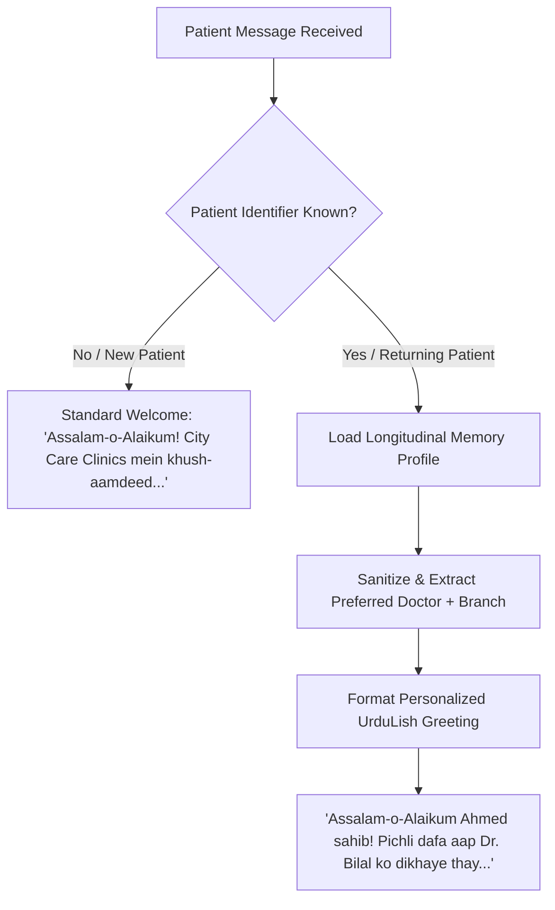

# City Care Clinics — Patient Memory Architecture & Privacy Specification

**Week 9 Capstone Project: Multi-Agent AI Clinic Assistant for Healthcare**  
**Document:** Day 4 Task 2 — Longitudinal Memory & Patient Privacy Protocol  
**Status:** Validated & Active  

---

## 1. Executive Summary

The **Patient Memory Subsystem** empowers City Care Clinics' multi-agent assistant with contextual awareness across consultations while rigorously safeguarding patient privacy.

Key features:
1. **Short-Term Session Memory:** Maintains active conversational context and slot negotiation state across multi-turn exchanges within an active session.
2. **Long-Term Longitudinal Memory:** Remembers returning patients across distinct visits, storing their preferred physician, primary clinic branch, preferred language, known drug allergies, and past chief complaints.
3. **Privacy-Preserving Architecture:** Implements strict data minimization. Never stores CNIC numbers, payment/credit card details, or unconstrained conversational transcripts in persistent memory.
4. **Culturally Warm Returning Patient Recognition:** Greets returning patients respectfully in UrduLish, directly acknowledging their previous doctor and encounter context.

---

## 2. Returning Patient Workflow & Greeting Algorithm

When a patient initiates contact via Web Chat, WhatsApp, or Telephony, the system checks their identifier against the persistent memory store:



### Reference Example:
> *"Assalam-o-Alaikum Ahmed Raza sahib! Pichli dafa aap Dr. Bilal Aslam ko dikhaye thay. Kya isi doctor ke saath appointment chahiye, ya kisi nayi takleef ke baray mein baat karni hai?"*

---

## 3. Privacy Guardrails & Security Model

In compliance with international healthcare standards (HIPAA / GDPR data minimization principles) and local regulations:

1. **Zero Financial Storage:** Bank account details, jazzcash/easypaisa numbers, credit card tokens, and payment identifiers are strictly excluded from memory schemas.
2. **National ID Isolation:** Pakistani National Identity Card (CNIC) numbers reside solely in the core encrypted FHIR patient registry and are never loaded into the conversational memory cache.
3. **Bounded Visit Retention:** Only the **last 3 clinic encounters** are retained in longitudinal memory. Older encounters are archived to the medical records database, preventing unbounded context bloat and data leakage.
4. **Zero Raw Transcript Retention:** Memory stores concise, structured clinical outcome summaries (e.g., *"Treated for acute otitis media; follow-up showed clear eardrum"*) rather than raw verbatim patient audio or transcripts.

---

## 4. Longitudinal Profile Schema (`PatientLongTermProfile`)

```json
{
  "patient_id": "PT_0002",
  "patient_name": "Ahmed Raza",
  "preferred_language": "UrduLish",
  "preferred_doctor_id": "DOC_008",
  "preferred_doctor_name": "Dr. Bilal Aslam",
  "preferred_branch": "City Care Clinics — DHA Branch",
  "known_allergies": [],
  "chronic_conditions": [
    "Pediatric recurrent otitis"
  ],
  "recent_visits": [
    {
      "visit_date": "2026-09-02",
      "doctor_name": "Dr. Bilal Aslam",
      "specialty": "Paediatrics",
      "branch_name": "City Care Clinics — DHA Branch",
      "chief_complaint": "Bachay ko kaan mein dard aur bukhar",
      "outcome_summary": "Treated for acute otitis media; follow-up showed clear eardrum."
    }
  ],
  "special_notes": "Parent brings child (age 5); prefers Dr. Bilal for gentle care.",
  "last_updated": "2026-10-08T15:20:00Z"
}
```
