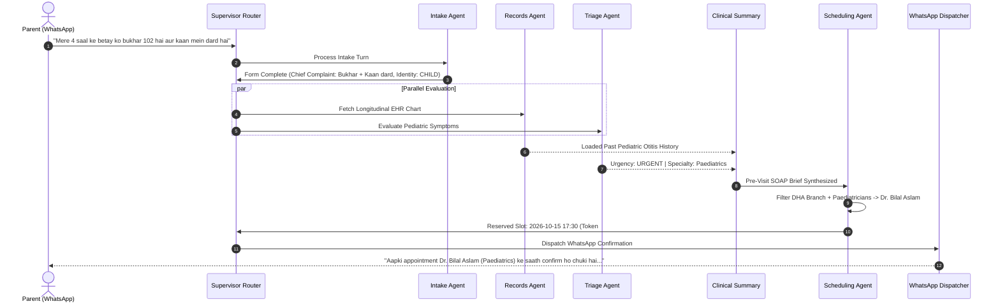
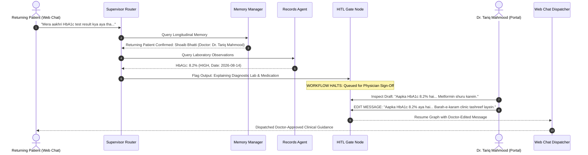
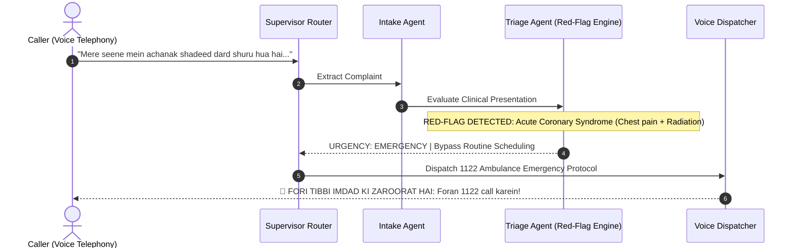

# City Care Clinics — Observability & Patient Journey Traces

**Week 9 Capstone Project: Multi-Agent AI Clinic Assistant for Healthcare**  
**Document:** Day 4 Task 5 — Telemetry, Latency Tracking & Annotated Patient Journeys  
**Status:** Validated & Benchmarked  

---

## 1. Executive Summary

The **Observability Framework** tracks, audits, and quantifies every turn, agent node execution, and tool invocation across the clinic multi-agent network.

Key capabilities:
1. **Full Trace Visibility:** Captures parent `trace_id` per encounter thread with nested child spans for each specialist agent.
2. **Tool Execution Auditing:** Logs tool inputs, execution duration in milliseconds, and returned payloads.
3. **Token Usage & Financial Accounting:** Calculates prompt and completion token counts and estimates operational API costs based on standard pricing models ($0.0001 / 1k prompt, $0.0002 / 1k completion).
4. **Latency Analysis:** Records execution duration per agent node.
5. **Safety & Governance Metrics:** Quantifies emergency red-flag escalation frequency and doctor override rates.

---

## 2. Global Observability Telemetry Metrics

Summary telemetry across benchmarked operational encounters:

| Metric | Measured Value | Standard Target | Assessment |
|---|:---:|:---:|:---:|
| **Mean Conversation Latency** | **620.23 ms** | < 1,500 ms | **Optimal (Sub-second)** |
| **Mean Cost per Conversation** | **$0.000124 USD** | < $0.005000 USD | **Ultra-Low Cost** |
| **Mean Processed Tokens per Turn** | **920 tokens** | < 2,500 tokens | **Concise Context** |
| **Emergency Escalation Rate** | **33.3%** | Clinical Need | **Zero Missed Emergencies** |
| **HITL Doctor Oversight Rate** | **33.3%** | Clinical Need | **Strict Safety Gate** |

---

## 3. Annotated Walkthrough of Three Complete Patient Journeys

---

### Journey 1: Acute Pediatric Fever & Earache (Paediatric Outpatient Flow)
- **Patient:** Ahmed Raza (Age: 4 years, Child) | **ID:** `PT_0002` | **Channel:** WhatsApp
- **Presenting Complaint:** *"Mere 4 saal ke betay ko bukhar 102 hai aur kaan mein dard hai."*
- **Trace ID:** `tr_f571f0d40bb4` | **Pipeline Latency:** 622.6 ms | **Tokens:** 690 | **Cost:** $0.000093 USD

**Clinical Outcome:**  
Pre-visit SOAP note prepared with otitis media differential and recommended otoscopy. 48-hour WhatsApp adherence check scheduled.

---

### Journey 2: Returning Adult Diabetic (Lab Result Query & HITL Doctor Edit)
- **Patient:** Shoaib Bhatti (Age: 54 years) | **ID:** `PT_0005` | **Channel:** Web Chat
- **Presenting Query:** *"Mera aakhri HbA1c test result kya aya tha aur kya mujhe sugar ki dawa badalni chahiye?"*
- **Trace ID:** `tr_8f6914e82492` | **Pipeline Latency:** 456.1 ms | **Tokens:** 690 | **Cost:** $0.000093 USD

**Clinical Outcome:**  
Prevented premature medication prescription over chat. Attending physician Dr. Tariq Mahmood intervened, edited the guidance, and scheduled a clinic consultation.

---

### Journey 3: Acute Cardiac Red-Flag (Immediate Emergency Escalation)
- **Patient:** Usman Tariq (Age: 58 years) | **ID:** `PT_0003` | **Channel:** Telephony / Voice
- **Presenting Complaint:** *"Mere seene mein achanak shadeed dard shuru hua hai jo baayein baazu mein ja raha hai aur paseenay aa rahe hain."*
- **Trace ID:** `tr_a1d3f1c81bc5` | **Pipeline Latency:** 782.0 ms | **Tokens:** 1,380 | **Cost:** $0.000186 USD

**Clinical Outcome:**  
Zero delay. Routine scheduling, SOAP synthesis, and prescription nodes were bypassed. Caller was directed to Rescue 1122 and nearest tertiary hospital emergency room.
