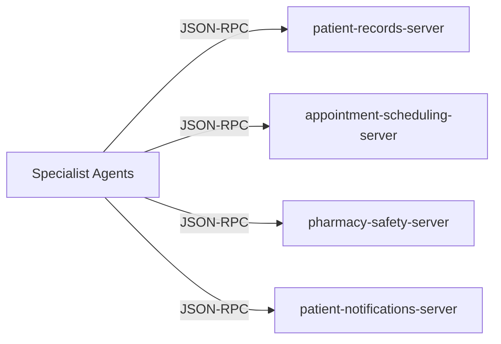

# City Care Clinics — API & MCP Server Technical Reference
**Document ID:** CCC-TECH-API-MCP-2026  
**Version:** v1.0.0 Production  
**Transport Protocols:** HTTP / REST (FastAPI) • JSON-RPC (Model Context Protocol / FastMCP)  
**Port Allocations:** FastAPI Gateway `:8000` • Streamlit Doctor Dashboard `:8501` • Streamlit Patient Chat `:8502`  

---

## 1. FastAPI Gateway Technical Reference

The FastAPI gateway serves as the primary integration interface for clinical portals, mobile apps, and WhatsApp webhook connectors.

### 1.1. Base URL & Common Headers
* **Base URL:** `http://localhost:8000` (or `https://api.citycareclinics.pk`)
* **Headers:**  
  `Content-Type: application/json`  
  `X-Clinic-API-Key: <CCC_PRODUCTION_KEY>`  

---

### 1.2. Core Endpoint Specifications

#### `GET /health`
System liveness and readiness probe for Docker / Kubernetes orchestrators.
* **Response (200 OK):**
```json
{
  "status": "UP",
  "service": "City Care Clinics Multi-Agent API",
  "database": "ACTIVE",
  "supervisor_graph": "ACTIVE",
  "supported_branches": 5,
  "certified_doctors": 30,
  "version": "1.0.0"
}
```

---

#### `GET /api/v1/clinic/branches`
Lists all 5 accredited physical clinic branches in Lahore and Islamabad.
* **Response (200 OK):**
```json
[
  {
    "id": "BR_0001",
    "name": "City Care Clinics — Gulberg Branch",
    "city": "Lahore",
    "address": "Plot 12-B, Main Boulevard, Gulberg III, Lahore",
    "operating_hours": "08:00 - 22:00"
  },
  {
    "id": "BR_0002",
    "name": "City Care Clinics — DHA Branch",
    "city": "Lahore",
    "address": "Sector Y, Phase 3, DHA, Lahore",
    "operating_hours": "08:00 - 23:00"
  }
]
```

---

#### `GET /api/v1/clinic/doctors`
Returns list of credentialed clinic doctors, filterable by medical specialty and branch.
* **Query Parameters:** `specialty` (optional, e.g. `Paediatrics`), `branch_id` (optional)
* **Response (200 OK):**
```json
[
  {
    "id": "DOC_0002",
    "name": "Dr. Ayesha Malik",
    "specialty": "Paediatrics",
    "branch_id": "BR_0001",
    "consultation_fee_pkr": 2500,
    "shift_hours": "17:00-21:00"
  }
]
```

---

#### `POST /api/v1/triage`
Executes zero-latency deterministic symptom evaluation and red-flag screening.
* **Request Body:**
```json
{
  "symptom_text": "Kaan mein shadeed dard hai aur 102 bukhar hai",
  "patient_age": 4,
  "is_pediatric": true
}
```
* **Response (200 OK):**
```json
{
  "urgency_tier": "URGENT",
  "is_emergency": false,
  "matched_specialty": "Paediatrics",
  "confidence_score": 0.95,
  "decision_path": "DETERMINISTIC_RULES",
  "clinical_reasoning": "Acute severe symptoms or high fever warrant same-day urgent physician review."
}
```

---

#### `POST /api/v1/chat`
Executes a full conversational turn through the compiled LangGraph supervisor and specialist agent workflow.
* **Request Body:**
```json
{
  "thread_id": "chat_session_8819",
  "user_message": "Chehray par shadeed acne aur daanay nikal rahe hain",
  "patient_id": "PT_0001",
  "patient_name": "Ali Khan",
  "channel": "web_chat"
}
```
* **Response (200 OK):**
```json
{
  "thread_id": "chat_session_8819",
  "final_patient_response": "Aapki appointment Dr. Mahnoor Tariq (Dermatology) ke saath 2026-10-15 17:30 ko confirm ho chuki hai. Aapka Token #4 hai. Consultation fee PKR 2200 hai.",
  "matched_specialty": "Dermatology",
  "urgency_tier": "ROUTINE",
  "is_emergency": false,
  "hitl_status": "NONE",
  "appointment_booking": {
    "booking_id": "APPT_7712",
    "slot_datetime": "2026-10-15 17:30",
    "token_number": 4
  }
}
```

---

#### `GET /api/v1/hitl/queue`
Retrieves pending clinical reviews waiting for physician sign-off on the Doctor Dashboard.
* **Response (200 OK):**
```json
[
  {
    "request_id": "HITL_001",
    "thread_id": "session_992",
    "patient_id": "PT_0042",
    "patient_name": "Hamza Tariq",
    "category": "LAB_RESULT_EXPLANATION",
    "status": "PENDING",
    "draft_message": "Aapka HbA1c test 7.8% aya hai jo ke elevated hai...",
    "created_at": "2026-10-08T15:30:00"
  }
]
```

---

#### `POST /api/v1/hitl/review`
Submits doctor approval, edits, or rejection for a pending clinical review item.
* **Request Body:**
```json
{
  "request_id": "HITL_001",
  "decision": "APPROVED",
  "doctor_id": "DOC_0001",
  "doctor_notes": "Explanation approved without modifications."
}
```
* **Response (200 OK):**
```json
{
  "status": "PROCESSED",
  "decision": "APPROVED",
  "request_id": "HITL_001",
  "updated_at": "2026-10-08T15:35:12"
}
```

---

## 2. MCP Servers Technical Reference

The system utilizes four modular Model Context Protocol (MCP) servers built with FastMCP over standard JSON-RPC.



### 2.1. Server 1: Patient Records Server (`patient-records-server`)
* **Source:** `week9/Day2/src/mcp_servers/patient_records_server.py`
* **Port / Transport:** Stdio / FastMCP
* **Exposed Tools:**
  1. `get_full_patient_chart(patient_id: str)`: Returns complete longitudinal medical chart, chronic conditions, and previous visits.
  2. `get_patient_allergies(patient_id: str)`: Returns list of documented allergic substances (e.g., Penicillin, Sulfa, Aspirin).
  3. `get_patient_lab_results(patient_id: str, test_code: Optional[str])`: Returns quantitative lab results, units, and reference ranges.
  4. `update_patient_conditions(patient_id: str, new_condition: str)`: Appends newly diagnosed clinical condition to chart.

---

### 2.2. Server 2: Appointment Scheduling Server (`appointment-scheduling-server`)
* **Source:** `week9/Day2/src/mcp_servers/appointment_scheduling_server.py`
* **Port / Transport:** Stdio / FastMCP
* **Exposed Tools:**
  1. `search_doctors(specialty: Optional[str], branch_id: Optional[str], max_fee_pkr: Optional[int])`: Returns matched practitioner cards.
  2. `get_available_slots(doctor_id: str, target_date: str)`: Calculates free 15-minute consultation slots on specified date.
  3. `book_appointment(patient_id: str, doctor_id: str, slot_datetime: str, chief_complaint: str)`: Creates confirmed booking with queue token.
  4. `reschedule_appointment(appointment_id: str, new_slot_datetime: str)`: Updates existing slot with conflict verification.
  5. `cancel_appointment(appointment_id: str, reason: str)`: Frees the reserved calendar slot.

---

### 2.3. Server 3: Pharmacy Safety Server (`pharmacy-safety-server`)
* **Source:** `week9/Day2/src/mcp_servers/drug_database_server.py`
* **Port / Transport:** Stdio / FastMCP
* **Exposed Tools:**
  1. `lookup_drug(drug_name: str)`: Normalizes brand/generic names and returns maximum daily adult/pediatric doses.
  2. `check_allergy_clashes(proposed_drug: str, patient_allergies: List[str])`: Cross-checks drug class against allergy profiles.
  3. `check_drug_interactions(drug_a: str, drug_b: str)`: Returns deterministic interaction severity (CRITICAL_DANGER, WARNING_MODERATE) and mechanism.
  4. `verify_dosage(drug_name: str, dose_mg: float, frequency: str, patient_age: int, weight_kg: float)`: Assesses 24-hour ceiling limits.

---

### 2.4. Server 4: Patient Notifications Server (`patient-notifications-server`)
* **Source:** `week9/Day2/src/mcp_servers/notifications_server.py`
* **Port / Transport:** Stdio / FastMCP
* **Exposed Tools:**
  1. `send_whatsapp_message(to_phone: str, message_body: str)`: Dispatches encrypted UrduLish message with mock delivery receipt.
  2. `send_sms_message(to_phone: str, text: str)`: Dispatches SMS backup notification.
  3. `send_email_confirmation(to_email: str, subject: str, html_content: str)`: Sends official consultation appointment email.
  4. `schedule_reminder(patient_id: str, reminder_type: str, execute_at: str, payload: dict)`: Registers future follow-up task.
