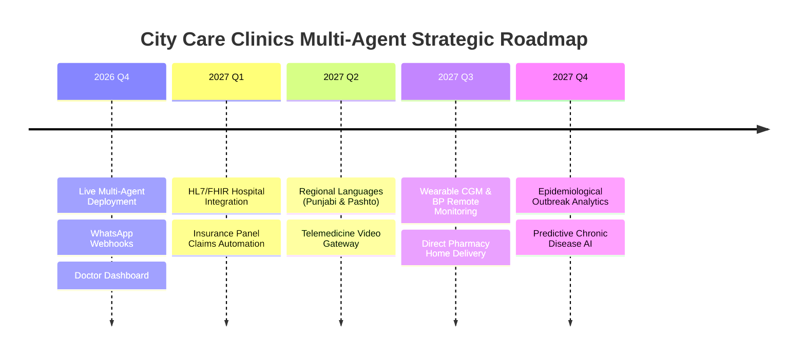

# City Care Clinics — Future Roadmap & Strategic Technical Enhancements
**Document ID:** CCC-STRAT-ROADMAP-2027  
**Planning Horizon:** 2026 Q4 – 2027 Q4  
**Author:** AI Solutions & Enterprise Healthcare Architecture Team  
**Approved By:** Medical Directorate & Executive Board  

---

## 1. Overview & Strategic Goals

Following the successful deployment of the v1.0.0 Multi-Agent Clinic Assistant across the 5 outpatient clinics in Lahore and Islamabad, this roadmap outlines high-impact technological and clinical expansions for Phase 2 and Phase 3.



---

## 2. Core Strategic Enhancements

### 2.1. Enterprise HL7 / FHIR Hospital System Integration
* **Objective:** Connect City Care Clinics outpatient nodes with major tertiary care hospital electronic medical records (EMR) across Pakistan (e.g. Shaukat Khanum, Shifa International, Doctors Hospital, Indus Hospital).
* **Technical Architecture:**
  - Implement bidirectional **HL7 v2.x and FHIR R4 REST APIs** (`/Patient`, `/Encounter`, `/DiagnosticReport`, `/CarePlan`).
  - Automated ingestion of pathology lab PDFs and digital radiology (DICOM PACS web viewer links) directly into the Records Agent.
  - Standardized SMART on FHIR authorization protocols for patient health data exchange.

---

### 2.2. Integrated Telemedicine Video Consultations
* **Objective:** Enable remote consultations for rural and non-ambulatory patients across Punjab and Khyber Pakhtunkhwa.
* **Technical Architecture:**
  - Automated WebRTC / Agora video consult room provisioning upon appointment confirmation.
  - One-click encrypted video link delivered via SMS and WhatsApp 15 minutes before the scheduled slot.
  - In-call digital prescription pad with real-time pharmacological safety validation and digital cryptographic physician signature.

---

### 2.3. Insurance & Corporate Panel Claim Handling
* **Objective:** Streamline third-party payer claims (State Life Sehat Sahulat Card, Jubilee Life, EFU, corporate panels).
* **Technical Architecture:**
  - Dedicated **Insurance Agent** validating real-time policy active status and coverage limits via National Sehat Card API and corporate insurance gateways.
  - Automated pre-authorization request generation based on pre-visit SOAP notes and diagnostic test orders.
  - Instant co-pay calculation and cashless OPD settlement at the front desk.

---

### 2.4. Regional Languages Expansion: Punjabi & Pashto
* **Objective:** Eliminate linguistic barriers for patients in northern and rural Punjab and KP regions who prefer spoken or written Punjabi (Shahmukhi) and Pashto over Roman Urdu.
* **Technical Architecture:**
  - Fine-tuned domain-adapted regional speech models (Whisper / SeamlessM4T) for colloquial audio voice notes on WhatsApp.
  - Culturally tuned clinical prompt templates for Pashto (*"Staso da sar dard sanga dai?"*) and Punjabi (*"Sir vich kinna dard hai ji?"*).
  - Bilingual doctor-patient audio transcription and automated SOAP note translation into English clinical records.

---

### 2.5. Remote Patient Monitoring via Wearable Data (BP & Continuous Glucose)
* **Objective:** Transform City Care Clinics from episodic outpatient clinics into continuous preventive health hubs.
* **Technical Architecture:**
  - Ingestion pipelines for Bluetooth and cloud-connected IoT devices (Abbott FreeStyle Libre CGM, Omron smart BP cuffs, Apple HealthKit, Google Health Connect).
  - Automated algorithmic outlier detection: If a diabetic patient's 7-day fasting sugar averages $> 180\text{ mg/dL}$, or BP spikes $> 160/100$, the system proactively generates an alert for their primary care doctor and sends an empathetic check-in via WhatsApp.

---

### 2.6. Integrated Pharmacy Home Delivery
* **Objective:** Eliminate prescription drop-off and medication procurement delays.
* **Technical Architecture:**
  - Upon doctor sign-off on the dashboard, the validated e-prescription is automatically transmitted to the nearest City Care Clinics dispensing pharmacy.
  - Integration with on-demand logistics partners (Bykea / Yango Delivery) for cold-chain insulin and medication delivery within 45 minutes in Lahore and Islamabad.
  - Cash-on-delivery (COD) and 1Link / Raast instant digital payment links sent via WhatsApp.

---

### 2.7. Epidemiological Analytics & Network Disease Trend Mapping
* **Objective:** Provide public health surveillance and clinic operational resource forecasting across all 5 branches.
* **Technical Architecture:**
  - Automated anonymized symptom aggregation pipeline calculating 7-day moving averages of clinical complaints.
  - Early-warning outbreak detection for regional epidemics (e.g. Dengue fever clusters in Gulberg/DHA, seasonal influenza spikes, smog-induced asthma crises in Lahore during October–December).
  - Real-time heatmaps for clinic management to dynamically allocate nebulizers, rapid dengue NS1 antigen kits, and pediatric specialists to affected branches.

---

## 3. Implementation Phasing & Resource Requirements

```
┌─────────┬──────────────────────────────────────────┬────────────────────────────┐
│ Phase   │ Enhancement Workstream                   │ Engineering Effort         │
├─────────┼──────────────────────────────────────────┼────────────────────────────┤
│ Phase 2 │ HL7 / FHIR APIs & Insurance Automation   │ 8 Weeks (2 Backend + 1 QA) │
│ Phase 2 │ Punjabi & Pashto Voice WhatsApp Pipeline │ 6 Weeks (2 Speech/ML)      │
│ Phase 3 │ Telemedicine Video Consultations         │ 4 Weeks (1 WebRTC Eng)     │
│ Phase 3 │ Wearable Remote Monitoring & Pharmacy    │ 8 Weeks (2 Fullstack/IoT)  │
│ Phase 3 │ Outbreak Analytics & Epidemiological AI  │ 4 Weeks (1 Data Sci/Ops)   │
└─────────┴──────────────────────────────────────────┴────────────────────────────┘
```

---

## 4. Summary & Strategic Impact

These seven enhancements position City Care Clinics as the most technologically advanced, patient-centric outpatient network in South Asia, simultaneously improving clinical outcomes, scaling physician capacity, and capturing substantial commercial market share.
