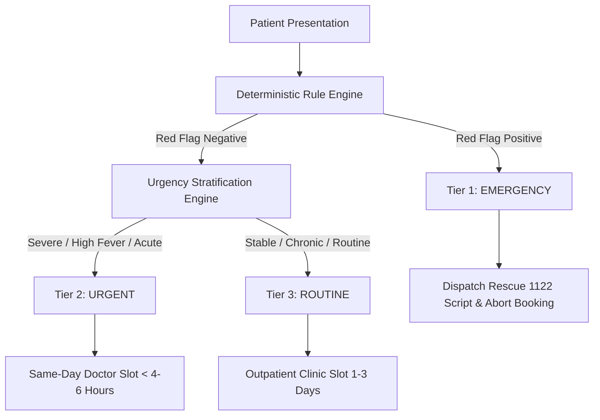
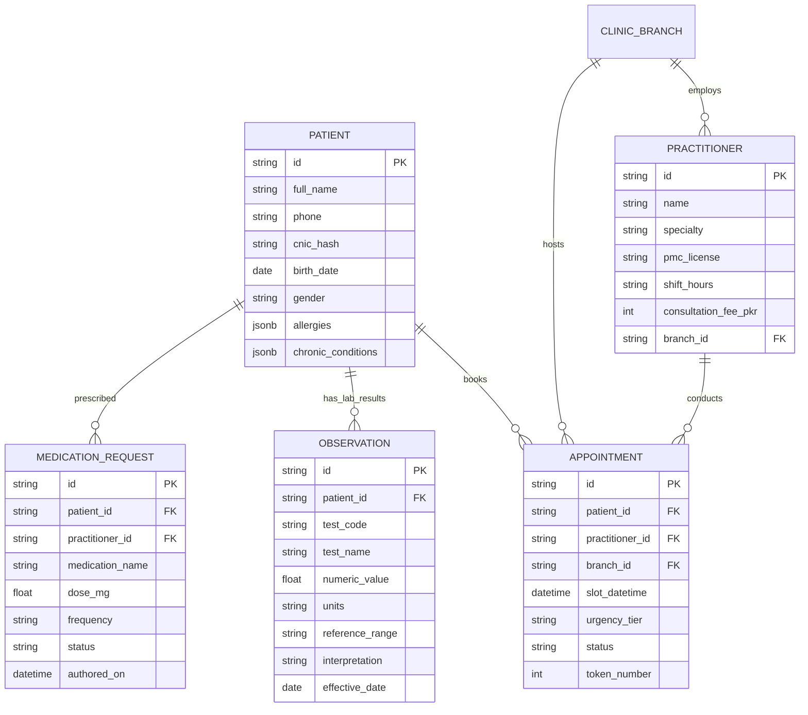

# City Care Clinics — Safety Policy, Clinical Triage Protocol & Privacy Architecture
**Document ID:** CCC-POL-SAFETY-PRIVACY-2026  
**Compliance Standard:** Punjab Healthcare Commission (PHC) Standards • HIPAA Security Rule Reference • FHIR R4  
**Scope:** Network-wide (5 Branches, 30 Doctors, Front-Desk & Conversational Agents)  
**Effective Date:** October 8, 2026  

---

## 1. Safety & Triage Governance Policy

### 1.1. Core Clinical Safety Principles
1. **First, Do No Harm (Primum Non Nocere):** The AI assistant functions as a clinical administrative and triage support tool. It is legally and clinically prohibited from issuing definitive autonomous medical diagnoses or final prescription orders.
2. **Deterministic Primacy:** Red-flag emergency detection and pharmacological conflict checks are strictly deterministic. LLM reasoning can augment urgency explanations but **cannot override, downgrade, or dismiss** an active deterministic red-flag or drug interaction alert.
3. **Emergency Escalation Mandate:** Any presentation matching acute cardiovascular compromise, stroke, respiratory failure, active hemorrhage, neonatal fever (< 3 months), toxic ingestion, or psychiatric suicidality must immediately trigger emergency escalation (Rescue 1122 + Emergency Department directive) and abort standard clinic booking.
4. **Human-in-the-Loop (HITL) Gate:** All clinical explanations of diagnostic laboratory results, off-label guidance, and medication changes must be staged in the Doctor Dashboard and verified by a licensed medical practitioner before delivery to the patient.

---

## 2. Emergency Triage Protocols & Tier Definitions

### 2.1. Triage Tier Specifications

| Urgency Tier | Clinical Definition | Target Response Window | Escalation Pathway |
| :--- | :--- | :---: | :--- |
| **Tier 1: EMERGENCY** | Imminent threat to life, limb, or neurological function (e.g. STEMI, CVA, hypoxic respiratory distress, heavy hemorrhage, overdose). | **< 30 seconds** | Immediate short-circuit to Rescue 1122; display designated emergency hospital addresses in Lahore & Islamabad; notify on-call medical director. |
| **Tier 2: URGENT** | Acute medical distress requiring same-day physician evaluation but without immediate hemodynamic instability (e.g. fever $\ge 102.5^\circ\text{F}$, severe pain scale $\ge 8/10$, pediatric gastroenteritis, acute asthma flare). | **< 4–6 hours** | Prioritize same-day doctor consultation slot; alert front desk to hold walk-in buffer slot; advise home hydration/safety measures. |
| **Tier 3: ROUTINE** | Stable chronic condition review, minor self-limiting symptoms, preventive screening, vaccine follow-up, or general health check. | **1–3 business days** | Book regular 15-minute outpatient slot with appropriate specialist; issue appointment token and calendar invite. |

---

## 3. Privacy Architecture & Data Protection

### 3.1. FHIR-Inspired Relational Data Layer
The clinic data layer mirrors HL7 FHIR (Fast Healthcare Interoperability Resources) R4 concepts across five core entities:

### 3.2. Data Privacy & Zero-Leak Safeguards
1. **CNIC Anonymization & Hashing:** National Identity Card numbers (CNIC) are salted and hashed using SHA-256 before database insertion. Full 13-digit identity numbers are never logged in plaintext or passed into LLM context windows.
2. **Session Tenant Isolation:** Inbound chat requests require verified channel tokens. State queries cannot access charts across disparate `patient_id` partitions.
3. **Anti-Exfiltration Redaction:** All outbound LLM responses pass through an automated privacy regex filter that redacts accidental occurrences of telephone numbers, CNICs, or third-party patient names.
4. **Audit Logging & Telemetry:** Every patient interaction, node transition, HITL approval, and tool execution is recorded in an immutable audit ledger (`observability.py`) with microsecond timestamps and operator identifiers.

---

## 4. Prescription Safety & Pharmacological Guardrails

### 4.1. Three-Tier Prescription Audit Engine
Before any proposed prescription order is presented to the patient or recorded in the medical chart, it must clear the three-tier verification engine:
1. **Allergy Conflict Matrix:** Cross-checks active substance and class against documented patient allergies (Penicillin family, Cephalosporins, Sulfa antibiotics, NSAIDs).
2. **Deterministic Drug-Drug Interaction (DDI) Filter:** Scans all pairs of proposed and active medications against severe pharmacological interactions (e.g. Warfarin + Aspirin, Warfarin + Ibuprofen, ACEI + NSAIDs).
3. **Maximum Daily Dose & Special Population Limits:** Enforces hard numerical caps on 24-hour drug totals (e.g. Paracetamol $\le 4000\text{ mg/day}$) and pediatric body-weight ratios ($\text{mg/kg/day}$).

---

## 5. Regulatory Certification

This policy has been reviewed and approved by the City Care Clinics Medical Directorate and Quality Assurance Committee. Compliance audits are executed continuously via automated CI test suites.
