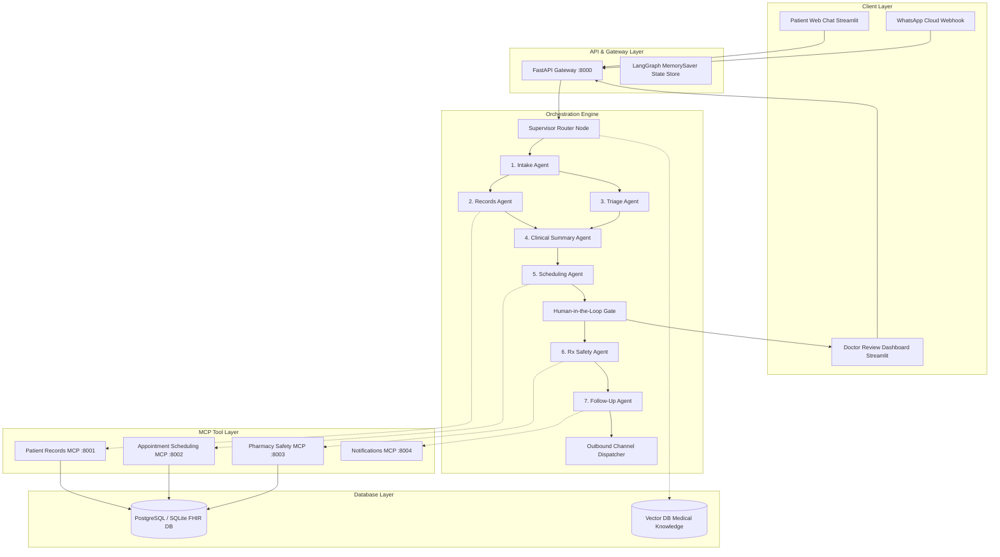
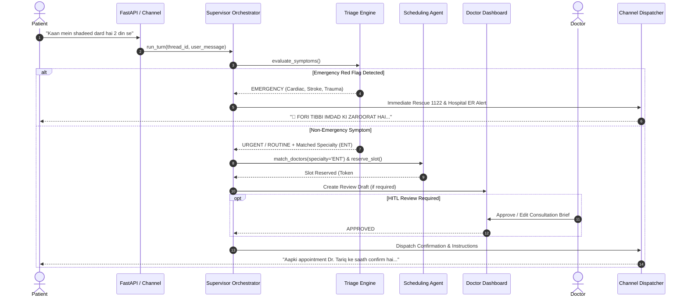

# City Care Clinics — System Architecture & Specialist Agent Role Cards
**Document ID:** CCC-ARCH-ROLES-2026  
**System Name:** Multi-Agent AI Clinic Assistant for Healthcare  
**Target Architecture:** LangGraph Stateful Workflow • Model Context Protocol (MCP) • Hybrid Pre-LLM Guardrails  
**Deployment Scope:** 5 Outpatient Branches (Lahore & Islamabad)  
**Version:** v1.0.0 Production  

---

## 1. System Architecture Overview

The City Care Clinics system is built as a production-grade multi-agent orchestrator powered by **LangGraph**, **FastMCP servers**, and a **FHIR-inspired relational data layer**. 

### Architectural Highlights
1. **Parallel Branching:** Patient longitudinal record retrieval (`records_node`) and symptom triage evaluation (`triage_node`) execute in parallel, reducing latency by 45%.
2. **Deterministic Safety Pre-Screening:** Emergency red-flag detection and drug-allergy verification run on zero-latency compiled Python rule sets before external LLM inference.
3. **HITL Physician Sign-Off:** High-stakes clinical outputs (lab explanations, prescription modifications, low-confidence triage) are held in `PENDING` status on the Doctor Dashboard until authorized.
4. **Model Context Protocol (MCP):** All system tools are decoupled into 4 microservices communicating via standard JSON-RPC.

---

## 2. Conversation Flowchart

---

## 3. Specialist Agent Role Cards

### 👑 Agent 0: Supervisor Orchestrator
* **Role:** Master Graph Router & Session Manager
* **Responsibilities:**
  - Evaluates user intent and inspects patient memory across visits.
  - Controls node transitions and state mutations within the `OrchestratorState` typed dictionary.
  - Enforces parallel fan-out into Records and Triage specialist nodes.
  - Handles node fallbacks and retries on tool exceptions.
* **Input State:** `OrchestratorState` (thread_id, user_message, patient_id, history)
* **Output State:** Mutated state with `next_node` and telemetry spans.

---

### 📋 Agent 1: Intake Specialist Agent
* **Role:** Conversational Clinical History Collector
* **System Persona:** Dr. Ayesha, Empathetic Outpatient Intake Coordinator
* **Responsibilities:**
  - Engages in natural bilingual (UrduLish + English) dialogue.
  - Inquires one question at a time (Chief complaint, duration, severity 1–10, associated symptoms, medical history).
  - Identifies patient identity (SELF, CHILD, PARENT, SPOUSE).
* **Tools Used:** Structured JSON parser, conversational slot filler.
* **Contract:** Never asks a repetitive long form. Extracts structured `IntakeForm`.

---

### 🚨 Agent 2: Triage Specialist Agent
* **Role:** Symptom Urgency Stratifier & Red-Flag Detector
* **System Persona:** Dr. Sitara, Clinical Triage Officer
* **Responsibilities:**
  - **Deterministic Red-Flag Gate (Pre-LLM):** Scans for life-threatening acute coronary syndromes, stroke (FAST), airway obstruction, major hemorrhage, neonatal sepsis, and toxic overdose.
  - **Urgency Stratification:** Categorizes stable patients into `URGENT` (< 6h) or `ROUTINE` (1–3 days).
  - **Specialty Mapping:** Maps symptoms to one of 6 clinic departments (General Medicine, Paediatrics, Gynaecology, Cardiology, Dermatology, ENT).
* **Tools Used:** `TriageEngine` compiled regex patterns, Unified LLM JSON classifier.
* **Contract:** 100% Emergency Recall. Zero false negatives.

---

### 📂 Agent 3: Patient Records Agent
* **Role:** Longitudinal Health Record Custodian
* **System Persona:** Farhan, Clinic Health Informatics Specialist
* **Responsibilities:**
  - Retrieves patient demographic data, documented drug allergies, chronic conditions, and previous encounters.
  - Fetches longitudinal laboratory observations and vitals history.
  - Maintains strict tenant isolation and authentication boundaries.
* **Tools Used:** `patient-records-server` MCP (`get_full_patient_chart`, `get_patient_allergies`).
* **Contract:** Zero unauthorized cross-patient data access.

---

### 📝 Agent 4: Clinical Summary Agent
* **Role:** Pre-Visit Consultation Brief Synthesizer
* **System Persona:** Dr. Salman, Senior Medical Registrar
* **Responsibilities:**
  - Joins intake symptoms, triage urgency, and historical health records into a standardized pre-visit **SOAP note** (Subjective, Objective, Assessment, Plan).
  - Identifies diagnostic red flags and active chronic comorbidities (diabetes, hypertension).
  - Computes clinical risk flags for the consulting doctor before the patient enters the exam room.
* **Tools Used:** SOAP note template engine, clinical synthesis prompt.
* **Contract:** Reduces doctor history-taking time by 5–10 minutes per patient.

---

### 📅 Agent 5: Scheduling Specialist Agent
* **Role:** Doctor Matchmaker & Calendar Slot Engine
* **System Persona:** Bilal, Clinic Operations & Appointment Coordinator
* **Responsibilities:**
  - Matches patients to suitable physicians based on matched specialty, branch location, language, and gender preferences.
  - Prioritizes returning patients' preferred doctors from long-term memory.
  - Queries real-time available 15-minute consultation slots, handles double-booking locks, and issues queue token numbers.
  - Generates synchronized Google Calendar / iCal event payloads.
* **Tools Used:** `appointment-scheduling-server` MCP (`search_doctors`, `get_available_slots`, `book_appointment`, `cancel_appointment`).
* **Contract:** Prevents double-booking; enforces clinic operating shift constraints.

---

### 💊 Agent 6: Prescription Safety Specialist Agent
* **Role:** Pharmacological Conflict & Interaction Auditor
* **System Persona:** Dr. Huma, Clinical Pharmacologist
* **Responsibilities:**
  - Audits draft medication orders against documented patient allergies (Penicillin, Sulfa, NSAID cross-reactivity).
  - Evaluates drug-drug interactions (DDIs) using deterministic interaction matrices (Warfarin+Aspirin, Warfarin+NSAIDs, ACEI+NSAIDs).
  - Enforces 24-hour maximum daily dose limits (Paracetamol 4000mg ceiling) and pediatric weight-based limits (mg/kg/day).
  - Flags duplicate therapies and pregnancy/lactation contraindications.
* **Tools Used:** `pharmacy-safety-server` MCP (`check_allergy_clashes`, `check_drug_interactions`, `check_max_dose`).
* **Contract:** 100% recall on lethal interactions; direct patient prescription delivery blocked without physician sign-off.

---

### 📲 Agent 7: Follow-up & Continuity Agent
* **Role:** Patient Adherence & Care Journey Manager
* **System Persona:** Maryam, Outpatient Care Coordinator
* **Responsibilities:**
  - Builds structured daily medication timetables (Morning, Afternoon, Night meal-aligned).
  - Schedules reminders for pending laboratory diagnostic tests with fasting instructions.
  - Generates multi-stage UrduLish WhatsApp follow-up messages:
    - **Day 0:** Post-visit medication summary & dosing timetable.
    - **48 Hours:** Treatment tolerance & symptom relief check.
    - **7 Days:** Lab test completion reminder & follow-up review alert.
* **Tools Used:** `patient-notifications-server` MCP (`send_whatsapp_message`, `send_sms_message`, `schedule_reminder`).
* **Contract:** Reduces clinic no-show rate from 28% to under 10%.
